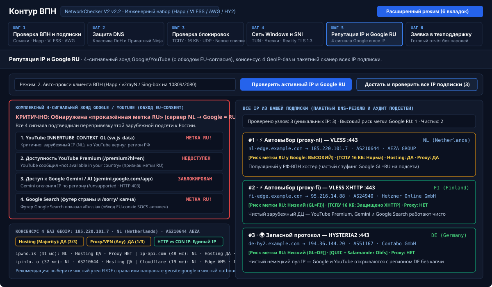

<div align="center">

# 🛡️ VPN_Checker

**Windows Desktop Diagnostics Suite for VPN Configs, Subscriptions, DPI/TSPU Fingerprints, Google `RU` Geo-Poisoning & AI Studio / Gemini Access**

[](https://dotnet.microsoft.com/)
[](https://learn.microsoft.com/dotnet/csharp/)
[](https://avaloniaui.net/)
[](https://github.com/AnfieldCorsair/VPN_Checker)
[](LICENSE)

**English (README.md)** · [Русский README](README.ru.md)

</div>

---

## Overview

**VPN_Checker** is a standalone **.NET 10 / Avalonia UI 12** desktop application for Windows designed to audit VPN subscriptions, diagnose ISP/DPI interference, inspect Windows TUN/IPv6 leaks, and detect Google `RU` geo-poisoning alongside independent **Google AI Studio / Gemini** availability.

The interface provides **two switchable modes** right from the top bar:

- **Basic Mode (default · 3 tabs)** — clean, distraction-free workspace for everyday checks:
  1. **VPN & Subscription Audit** — single input for subscription URLs (`https://`) or direct keys (`vless://`, `hy2://`, `trojan://`, `vmess://`, `ss://`, AmneziaWG), node selector, one-click reachability test, and plain-language verdicts.
  2. **IP Reputation & Google `RU`** — 6-signal live Google geo-poisoning detector with independent **AI Studio** & **Gemini** badges plus batch **RIPE/RDAP WHOIS** auditing for every server inside your subscription.
  3. **Support Ticket Generator** — two-step *Without VPN / With VPN* capture and masked report ready for Telegram support.
- **Advanced Mode (6 tabs)** — unlocks the full engineering suite: raw JSON/URI editor, presets, local `127.0.0.1` subscription hosting, DNS Architect (`DoH`/`DoT` injection), DPI/TSPU fingerprint tests (16 KB cutoff / UDP / whitelists), Windows network stack audit (`TUN` / `IPv6` / `MTU`), and `/24` Reality SNI scanner with live TLS 1.3 handshake verification.

---

## 🖼️ Interface Previews

### Minimalist Basic Mode (Default Startup · 3 Tabs)

> Clean workspace with zero raw-config clutter: paste a subscription URL or VPN key, pick a node, inspect verdicts, and check Google `RU` reputation.


---

### Advanced Mode (Full 6-Tab Engineering Suite)

#### 1. VPN & Subscription Audit (Happ / Xray JSON / VLESS / AWG / Hysteria2)


#### 2. DNS Protection Architect (Classic DoH / Private Ninja + Config Injection)


#### 3. DPI / TSPU Blocking Fingerprints (16 KB Cutoff, UDP Calls, DNS Spoofing, Whitelists)


#### 4. Windows Network Stack (TUN / IPv6 / MTU) & Reality SNI Hunter (TLS 1.3)


#### 5. IP Reputation, 6-Signal Google `RU` + AI Studio Detector & RIPE/RDAP Subscription Audit


#### 6. Support Ticket Builder (Telegram Report with Automatic Secret Masking)


---

## 🎯 How the 6-Signal Google `RU` Detector & RIPE/RDAP Audit Work (v2.3)

Foreign VPS subnets heavily used by VPN clients or owned by Russian LIRs often get re-tagged as **Russia (`RU`)** inside Google's geo database. Because Google maintains **separate geo tables** for YouTube/Play/Search and the **Google AI Studio / Generative Language API** gateway, an `RU`-tagged node can block YouTube Premium and Gemini while still allowing AI Studio (or vice versa).

In **v2.3**, the detector separates these signals cleanly:

- **EU Consent Wall Bypass**: attaches `SOCS` + `CONSENT` cookies and a desktop Chrome `User-Agent` so European nodes (`DE`, `NL`, `FI`, `PL`) return real geo payloads without redirecting to `consent.google.com`.
- **6 Parallel Independent Signals**:
  1. **YouTube `INNERTUBE_CONTEXT_GL`** — parses `youtube.com/sw.js_data` (keyed & positional arrays) with `youtube.com/?hl=en` and `/red` fallbacks.
  2. **YouTube Premium Availability** — checks `youtube.com/premium?hl=en` for *"not available in your country"* vs foreign subscription offers.
  3. **Google Play Region & Currency** — probes a paid app page (`com.mojang.minecraftpe&hl=en` without `&gl=`): `RUB` currency or hidden paid apps on a foreign IP confirm an `RU` tag.
  4. **Google Terms / Search & `/sorry/`** — reads `Country version:` from `policies.google.com/terms?hl=en`, the Search footer (`<div class="uU7dJb">...</div>`), and `HTTP 429` `/sorry/` reCAPTCHA blocks.
  5. **Google Gemini Web** — probes `gemini.google.com/app?hl=en` independently for `/unsupported` redirects and `HTTP 403`/`451`.
  6. **Google AI Studio + API Gateway** — probes `aistudio.google.com/prompts/new_chat` and `generativelanguage.googleapis.com/v1beta/models` (distinguishing `User location is not supported` geo-blocks from normal `Method doesn't allow unregistered callers`).
- **Separate AI Studio & Gemini Badges + Divergence Callout**: clearly separates the primary `RU`-tag verdict from independent `AI Studio` and `Gemini` status badges, explaining why AI Studio can allow access on a partially poisoned subnet.
- **Batch Subscription Audit with RIPE/RDAP WHOIS & Honest 4-Tier Risk Scale**:
  - **Critical (`RIPE/RU`)** — Russian GeoIP or Russian LIR/maintainer footprint discovered via `rdap.db.ripe.net` / `rdap.org`.
  - **High (`ASN/Proxy`)** — expanded catalog of ~50+ RU-popular VPN hosters/ASNs or positive `Proxy/VPN` database flags.
  - **Medium · Datacenter (Live Test Needed)** — unknown commercial datacenters are honestly marked as requiring live testing instead of falsely reporting "Low Risk".
  - **Low (`Clean ISP`)** — reserved strictly for non-hosting, non-proxy foreign ISPs with no RU RDAP footprint.
  - **Per-Node «Probe Live» Button**: switch to a node in Happ/v2rayN and click *Probe Live* — matching exit IPs (or `/24` subnets) automatically receive a verified live stamp with Google `RU`, AI Studio, Gemini, and Play currency results.

---

## 🏗️ Project Structure

```text
VPN_Checker.slnx
├── Directory.Build.props                # .NET 10, C# 14, TreatWarningsAsErrors=true, AnalysisMode=Recommended
├── LICENSE                              # GNU Affero General Public License v3.0 (AGPL-3.0)
├── build.ps1                            # Windows build, test & single-file publish script
├── src/
│   ├── VpnChecker.Core/                 # Pure C# diagnostics core (zero UI dependencies)
│   │   └── VpnAudit/
│   │       ├── VpnConfigParser.cs       # VLESS / XHTTP / Vision / AWG / Hysteria2 / Happ JSON parser
│   │       ├── VpnConfigAuditor.cs      # Audit rules & one-click patchers
│   │       ├── IpReputationProbe.cs     # 4 GeoIP + 6-signal Google/AI Studio probe + RIPE/RDAP scanner
│   │       ├── SubscriptionService.cs   # Subscription fetcher, traffic metadata, local 127.0.0.1 host
│   │       ├── BlockingFingerprintDetector.cs  # 16 KB cutoff, UDP, DNS spoofing, whitelist detector
│   │       ├── WindowsNetworkStackAuditor.cs   # Windows adapter audit (TUN, IPv6, MTU, local proxy ports)
│   │       ├── SubnetSniScanner.cs      # /24 Reality SNI hunter with live TLS 1.3 ServerHello check
│   │       └── SupportTicketBuilder.cs  # Masked Telegram & Markdown support report generator
│   └── VpnChecker.App/                  # Avalonia 12.1.4 + CommunityToolkit.Mvvm (Basic & Advanced UI)
└── tests/
    └── VpnChecker.Core.Tests/           # xUnit test suite (parsers, 6 Google signals, RDAP, DPI, Windows stack)
```

---

## 🚀 Build & Run (Windows)

Requires [.NET 10 SDK](https://dotnet.microsoft.com/download/dotnet/10.0) on Windows 10/11 x64.

```powershell
# 1. Clone the repository
git clone https://github.com/AnfieldCorsair/VPN_Checker.git
cd VPN_Checker

# 2. Build (TreatWarningsAsErrors enabled — 0 warnings)
dotnet build VPN_Checker.slnx -c Release

# 3. Run unit tests
dotnet test VPN_Checker.slnx -c Release

# 4. Launch desktop app
dotnet run --project src/VpnChecker.App -c Release
```

### Publish Self-Contained Single-File EXE (`VPN_Checker.exe`)

```powershell
# Using helper script
./build.ps1 -Publish -SelfContained

# Or directly via dotnet CLI
dotnet publish src/VpnChecker.App/VpnChecker.App.csproj `
  -c Release -r win-x64 --self-contained true `
  -p:PublishSingleFile=true -p:IncludeNativeLibrariesForSelfExtract=true
```

---

## 🔒 Privacy & Safety

- All diagnostics run locally from your machine with no telemetry servers.
- UUIDs, AmneziaWG/Reality private keys, passwords, and home IP suffixes are masked automatically in generated support tickets.
- Targeted DNS injection preserves every server endpoint, key, and routing rule intact.

---

## 📄 License

This project is licensed under the **GNU Affero General Public License v3.0 (AGPL-3.0)** — see the [LICENSE](LICENSE) file for the full text.
