# NetworkChecker

Приложение для Windows, которое проверяет компьютер по методике РКН: ищет признаки включённого VPN, системного прокси, туннелей и локальных клиентов обхода, а также показывает подробную картину сети.

Две аудитории в одном приложении:

- **«Просто»** — понятный ответ для обычного человека: «конфигурация обычная / есть отклонения / есть признаки обхода» + 6 фактов без терминов.
- **«Подробно»** — для тех, кому нужны метрики, находки по каждому модулю, сырые маршруты, DNS, MTU и трассировка.

**Стек:** .NET 10 LTS · Avalonia 12.1.4 · CommunityToolkit.Mvvm 8.4 · EF Core 10 + SQLite · Microsoft.Extensions.Hosting + DI · Serilog.

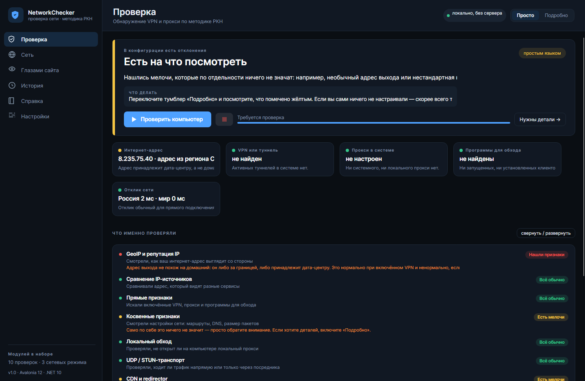

---

## Два режима интерфейса

Переключатель «Просто / Подробно» — в правом верхнем углу; выбор запоминается в `settings.json`.

| | Просто | Подробно |
|---|---|---|
| Ответ | крупный вердикт человеческим языком + «что делать» | счёт 0–100, причины, наблюдения IP-консенсуса |
| Модули | карточки «что проверяли» со статусом словами | полный список с метриками, находками и доказательствами |
| Сеть | полоса тона + 6 фактов (соединение, VPN/туннель, прокси, адрес выхода, DNS, MTU) | адаптеры, маршруты, NRPT, диагностика, трассировка |
| Глазами сайта | итог словами + список того, что узнаёт сайт | плюс пример заголовков клиента |
| Настройки | базовое | плюс списки целей: провайдеры GeoIP, домены, STUN, порты |

## Экспорт отчёта

Результат прогона выгружается в привычные форматы — кнопка «Экспорт» на экране проверки:

| Формат | Что получается |
|---|---|
| **PDF** | печатный отчёт: вердикт, находки, таблица модулей, окружение |
| **Word (DOCX)** | тот же отчёт как документ — можно править и дополнять |
| **Excel (XLSX)** | листы «Сводка», «Модули», «Находки», «IP-источники» |
| **CSV** | плоская таблица для своих сводных и скриптов |
| **Markdown** | отчёт для тикета, wiki или git-репозитория |
| **JSON** | полный машинный дамп прогона (для автоматизации и сравнения) |
| **HTML** | один самодостаточный файл: открывается в любом браузере, его не стыдно отправить письмом |

Кириллица в PDF встроена в файл (шрифт DejaVu, лицензия позволяет), внешние шрифты не нужны.
HTML-отчёт не тянет внешних стилей и скриптов — один файл, который работает и без интернета.

Посмотреть, как выглядит каждый формат, можно без запуска приложения: в папке
[`samples/`](samples) лежат отчёты об одном и том же прогоне во всех семи форматах —
`networkchecker-report.pdf`, `.docx`, `.xlsx`, `.csv`, `.md`, `.json`, `.html`.
Их создаёт тот же код экспорта, что и кнопка «Экспорт».

## Сравнение прогонов

История хранит каждый прогон локально. Кнопка «Сравнить с предыдущим» показывает, что изменилось
между двумя проверками: оценка риска `до → после`, статусы модулей, появившиеся и исчезнувшие находки,
и человеческий вывод («стало хуже: риск вырос на 20»). Удобно, когда включил или выключил VPN и хочешь
увидеть эффект, не читая два отчёта глазами.

---

## Глазами сайта

Экран показывает модель возможных сведений о посетителе, а не реальный взгляд ВК или Яндекса. IP и GeoIP получены от внешнего сервиса; системный язык и часовой пояс могут отличаться от браузерных. Запросы к самим сайтам не отправляются. Список заголовков — иллюстрация, не перехват фактического запроса браузера. Поясняется, что сайт не получает автоматически и что может получить через скрипты, разрешения или аккаунт.

Баллы — условная эвристика, **не вероятность VPN и не решение конкретного сайта**. Русский язык при IP ряда русскоязычных стран показан как контекст без языкового штрафа. Подробнее о весах, ограничениях и проверке экрана «Сеть»: [docs/REVIEW.md](docs/REVIEW.md). Для копирования значений и результатов выделите текст мышью и нажмите Ctrl+C; чувствительные данные в буфере могут быть доступны другим приложениям.

[HTML-презентация проекта](presentation.html).

## Схема трассировки

В «Сеть → Трассировка» показаны последовательность хопов и таблица результатов. Цвет объединяет хопы с одинаковым ASN; одинаковый цвет **не гарантирует** одинаковый ASN — палитра ограничена. Серый означает неизвестный ASN. Это логическая схема, не географическая карта; таймаут не обязательно означает обрыв. RTT — минимальное доступное измерение, на некоторых хопах его не будет. ASN определяется внешним DNS-сервисом Team Cymru, который получает запросы об IP хопов. Данные ASN могут отсутствовать или устареть. Режим приватности маскирует отображаемые IP; это не анонимизирует сетевые запросы. Схема заполняется после завершения трассировки и запросов ASN. [Пример схемы](screenshots/07b-network-trace-demo.png) использует вымышленные данные; [обычный снимок](screenshots/07-network-trace.png) показывает результат реальной пробы из тестовой среды.

## Язык интерфейса

В «Настройках» можно выбрать `ru-RU` или предварительный `en-US`, сохранить и перезапустить. Пока переведены навигация, часть шапки и элементы трассировки; результаты, большинство экранов, справка и отчёты остаются русскими. Полная локализация остаётся в roadmap. Язык интерфейса не меняет системную культуру и не подменяет язык системы во вкладке «Глазами сайта».

## Что внутри

| # | Модуль | Что делает | Вес |
|---|--------|-----------|-----|
| 1 | **GeoIP и репутация IP** | 4 независимых провайдера, majority vote по `hosting`, «хотя бы один» по `proxy/VPN/Tor`, страна выхода | 20 |
| 2 | **Сравнение IP-источников** | HTTP vs CDN vs STUN: один ли адрес видят разные пути (диагностика) | 0 |
| 3 | **Прямые признаки** | Прокси пользователя (WinINET) **и машины (WinHTTP)**, разбор PAC-скрипта, TUN/TAP-адаптеры, VPN-профили ОС, запущенные клиенты, установленные приложения, kill switch в файрволе | 30 |
| 4 | **Косвенные признаки** | Маршруты по умолчанию и /32, DNS (loopback, split-DNS/NRPT), MTU туннелей, hosts, виртуальные адаптеры | 20 |
| 5 | **Локальный обход** | Сканирование 21 порта на 127.0.0.1 (SOCKS5/HTTP-прокси), API Xray :10085, Clash/Mihomo :9090-9091 | 30 |
| 6 | **UDP / STUN-транспорт** | STUN binding, сравнение UDP- и TCP-адресов (утечка при проксировании только TCP), доступность MTProto | 10 |
| 7 | **CDN и redirector** | `cdn-cgi/trace`, `httpbin/headers`: страна edge-узла, прокси-заголовки | 5 |
| 8 | **Доступность доменов** | Цепочка DNS → TCP :443 → TLS по набору доменов: где именно ломается доступ | 10 |
| 9 | **RTT-триангуляция (β)** | Медиана задержки до RU-хостов против иностранных, jitter, потери; TCP-fallback, если ICMP заблокирован | 15 |
| 10 | **ICMP-спуфинг (β)** | Сверка ICMP и TCP: разные адреса ответа, «слишком близкий» ответ, ICMP при закрытом TCP | 10 |

Итог собирает `VerdictEngine`: взвешенная сумма `вес × серьёзность` нормируется в 0–100, поверх работают жёсткие правила (прямой `Critical` + подтверждение сетевыми данными → «Обнаружен обход»; расщепление IP-консенсуса → минимум «Требует проверки»).

### Вкладка «Сеть»

- **Овервью** — адаптеры (тип, MTU, MAC, IP, шлюз, DNS), маршруты по умолчанию, системный прокси, внешний IP с ASN/ISP, UDP-выход через STUN.
- **Диагностика** — задержка/jitter/потери по хостам, MTU пути через ICMP с *Don't Fragment*, запросы к каждому системному резолверу и DoH, TLS-сертификаты трёх узлов.
- **Трассировка** — ICMP traceroute (raw-сокет при наличии прав, иначе Ping с нарастающим TTL), до 64 хопов, ASN и оператор через DNS Team Cymru.

### Вкладка «Справка»

Отдельный справочник: как читать вердикт, что делает каждый модуль, какие данные читаются, и таблица соответствия Android-проверок и ПК-аналогов.

---

## Сборка и запуск

Нужен **.NET 10 SDK** (проверено на 10.0.403). Подробный пошаговый гайд для тех, кто собирает впервые, — в [docs/BUILD.md](docs/BUILD.md).
Что менялось от версии к версии — в [CHANGELOG.md](CHANGELOG.md).

Самый короткий путь (PowerShell в папке проекта):

```powershell
./build.ps1 -Publish
```

Скрипт восстановит пакеты, соберёт, прогонит тесты и положит готовый `NetworkChecker.exe` в `artifacts/win-x64`.

Вручную:

```powershell
dotnet restore
dotnet build
dotnet test                     # 319 тестов во всех четырёх тестовых проектах
dotnet run --project src/NetworkChecker.App
```

| Тестовый проект | Что покрывает | Тестов |
|---|---|---|
| `tests/NetworkChecker.Core.Tests` | чекеры, вердикт, консенсус IP, парсеры, DNS-wire, plain-язык, раннер, PAC, сравнение прогонов, эвристики hosts/маршрутов, разбор GeoIP и анализ «глазами сайта» | 235 |
| `tests/NetworkChecker.Export.Tests` | все семь форматов отчёта, кириллица, содержимое файлов | 29 |
| `tests/NetworkChecker.App.Tests` | ViewModel'и, режимы UI, навигация, сравнение прогонов, экран «глазами сайта», рендер экранов (headless) | 44 |
| `tests/NetworkChecker.Data.Tests` | история прогонов (EF Core/SQLite), settings.json | 11 |

Публикация:

```powershell
./build.ps1                       # Debug + тесты
./build.ps1 -Publish              # framework-dependent → artifacts/win-x64
./build.ps1 -Publish -SelfContained   # .NET не нужен на целевой машине
```

### Требования к ОС

Полный набор проверок — Windows 10/11:

- реестр (прокси, Uninstall, DRL/службы) — `Microsoft.Win32.Registry`;
- сетевые командлеты — `Get-NetRoute`, `Get-NetAdapter`, `Get-NetFirewallRule`, `Get-VpnConnection`;
- WinINET-настройки пользователя и машинные `DefaultConnectionSettings`.

На Linux/macOS проект собирается и запускается, но платформенный слой возвращает пустые значения (интерфейсы, маршруты, DNS читаются кроссплатформенно) — работают сетевые модули, остальное честно уходит в «Пропущено»/«Ошибка».

### Права администратора

Не обязательны: без них приложение полностью работоспособно и честно помечает недоступное.
Что можно получить с правами — raw-ICMP, WFP-фильтры, полный список процессов и служб —
разобрано в [docs/ADMIN.md](docs/ADMIN.md).

---

## Где лежат данные

`%LOCALAPPDATA%\NetworkChecker\`

| Файл | Что внутри |
|------|-----------|
| `settings.json` | настройки и списки целей (провайдеры, домены, STUN, порты) |
| `history.db` | история прогонов (SQLite, EF Core) |
| `logs\app-YYYYMMDD.log` | журнал Serilog, 7 дней |

Сервера нет: вся история и настройки — локальные файлы. Приватный режим маскирует IP/MAC в UI и в экспорте, офлайн-режим отключает все внешние запросы.

---

## Структура решения

```text
src/
├── NetworkChecker.Core            # модели, чекеры, вердикт, сетевые примитивы, экспорт
│   ├── Abstractions/            # ICheck, IPlatformProbe, IHttpProbe, CheckContext
│   ├── Checks/                  # 10 модулей проверки
│   ├── Verdict/                 # VerdictEngine, IpConsensusBuilder
│   ├── Net/                     # HTTP, DNS wire, TCP/TLS, STUN, ICMP, трассировка, ASN, PAC
│   ├── Comparison/              # сравнение двух прогонов
│   ├── SiteView/                # «глазами сайта»: разбор GeoIP, визитная карточка, выводы
│   ├── NetInfo/                 # сервис вкладки «Сеть» (обзор/диагностика/трасса)
│   ├── Export/                  # Markdown и JSON-отчёты (основа для остальных форматов)
│   └── SiteView/                # анализ «что видит сайт» (модели, парсер, анализатор)
├── NetworkChecker.Platform.Windows # IPlatformProbe: реестр, PowerShell, сеть, hosts
├── NetworkChecker.Data            # EF Core + SQLite, история, settings.json
├── NetworkChecker.Export          # PDF / DOCX / XLSX / CSV / Markdown / JSON
└── NetworkChecker.App             # Avalonia UI (MVVM, 6 экранов, два режима)
tests/
├── NetworkChecker.TestKit         # общие фейки: платформа, HTTP, чекеры, «эталонные» прогоны
├── NetworkChecker.Core.Tests
├── NetworkChecker.Export.Tests
├── NetworkChecker.App.Tests       # включая headless-рендер экранов
└── NetworkChecker.Data.Tests
tools/NetworkChecker.Screenshots   # рендер реальных экранов в PNG (для ревью UI)
```

Поток данных: `DashboardViewModel` → `CheckRunner` (параллельно, `MaxParallelChecks`) → `ICheck.RunAsync` → `VerdictEngine` + `IpConsensusBuilder` → `HistoryRepository` → UI/экспорт.

### Как добавить свою проверку

1. Реализовать `ICheck` в `Core/Checks` (категория, вес, `RunAsync`).
2. Зарегистрировать в `AppServices.Build`: `services.AddSingleton<ICheck, MyCheck>();`
3. Задать вес в `VerdictEngine.SeverityFactor`, если нужен нестандартный коэффициент.
4. Добавить описание в `GuideViewModel` (вкладка «Справка»).
5. Покрыть логику тестом в `tests/NetworkChecker.Core.Tests`.

---

## Соответствие Android-версии

| Android (RKNHardering) | ПК-реализация |
|---|---|
| `ConnectivityManager` / `TRANSPORT_VPN` | реестр WinINET + перечисление адаптеров `NetworkInterface` |
| `VpnService`, `dumpsys vpn_management` | TUN/TAP-адаптеры, `Get-VpnConnection`, службы/драйверы |
| `PackageManager` (список пакетов) | три ветки `Uninstall` в реестре |
| `NetworkInterface.getNetworkInterfaces()` | `NetworkInterface` + `Get-NetAdapter` |
| `/proc/net/route` | `Get-NetRoute` (fallback: `/proc/net/route` на Linux) |
| Private DNS / split DNS | `DnsAddresses`, NRPT (`DnsPolicyConfig`) |
| `BypassChecker` (localhost proxy) | тот же подход + API Xray/Clash |
| `NativeSignsChecker` (JNI) | нативные Windows API: реестр, файрвол, PowerShell |
| `RttTriangulationChecker` (SNITCH β) | ICMP + TCP-fallback |
| `LocationSignalsChecker` (MCC/SIM/BeaconDB) | не переносится (нет сотового модуля), частично закрыто GeoIP |

---

## Скриншоты

| | |
|---|---|
| **Простой режим, до запуска**<br>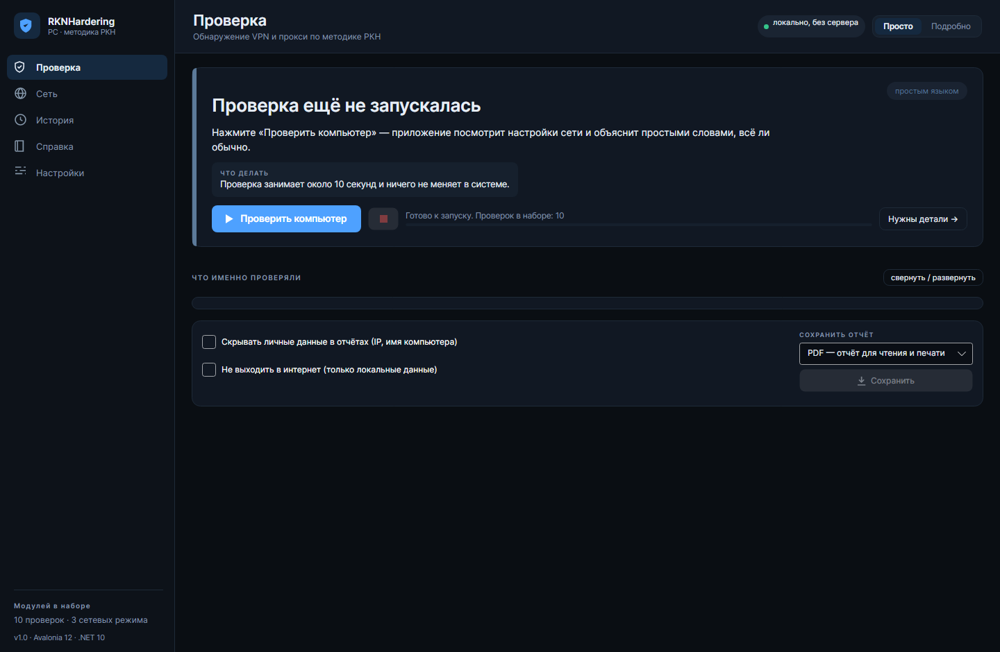 | **Простой режим, результат**<br> |
| **Подробный режим, результат**<br>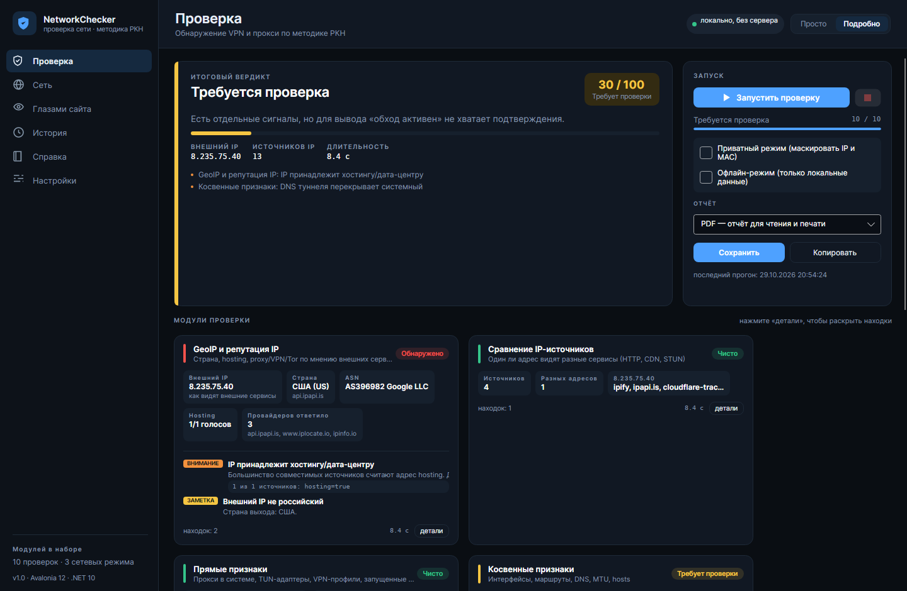 | **Сеть в простом режиме**<br>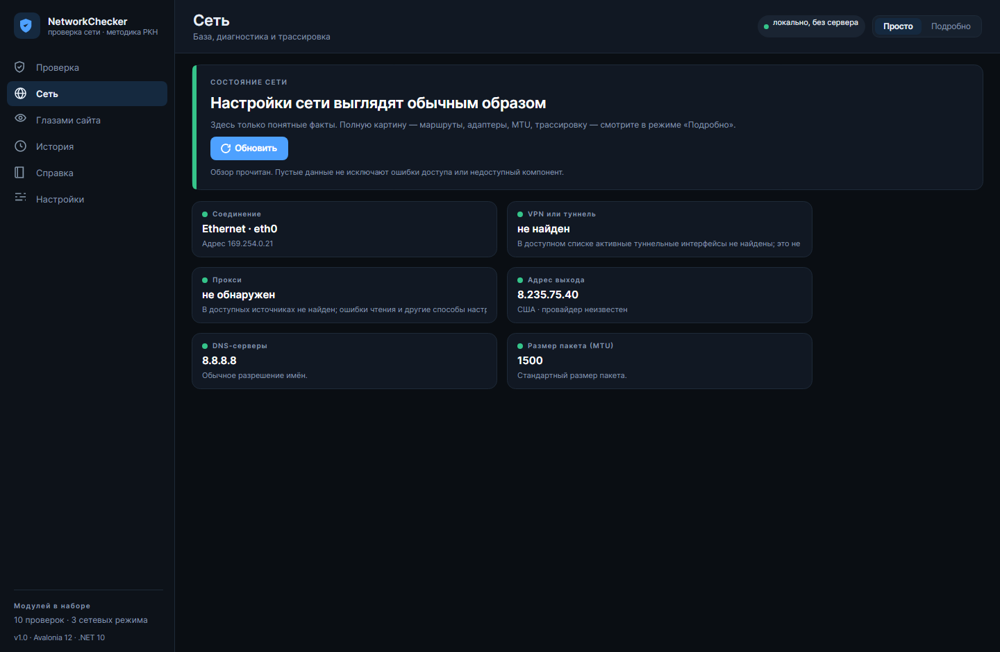 |
| **Сеть: овервью**<br>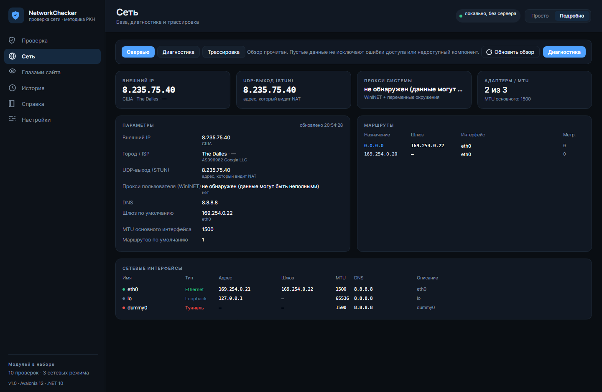 | **Сеть: диагностика**<br>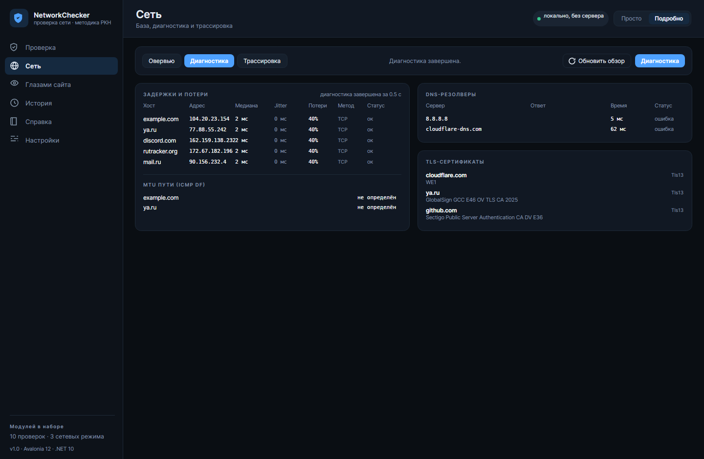 |
| **Сеть: трассировка**<br>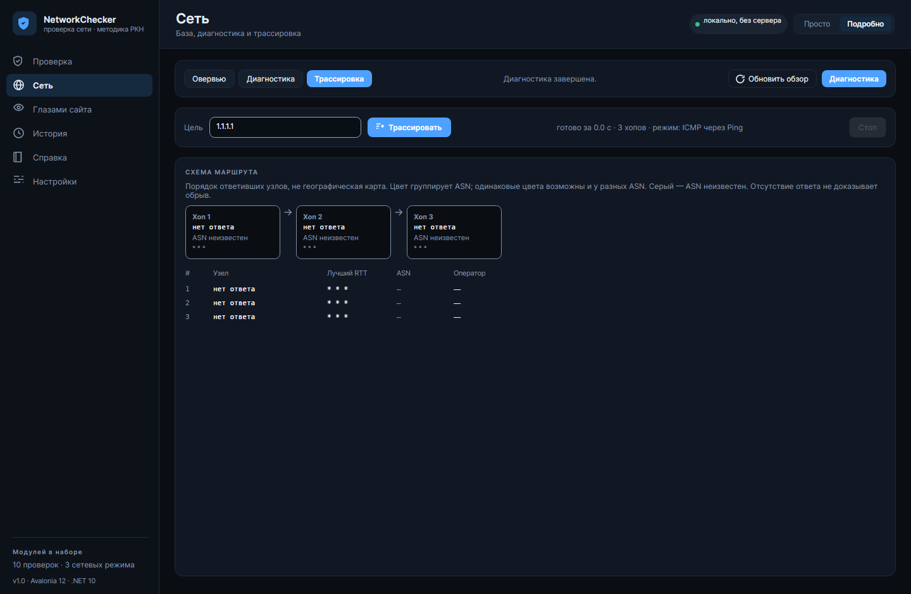 | **История**<br>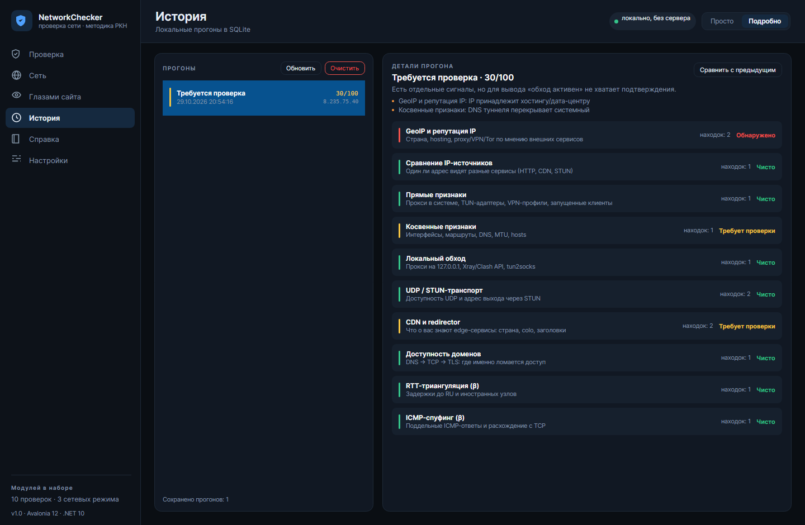 |
| **Сравнение прогонов**<br>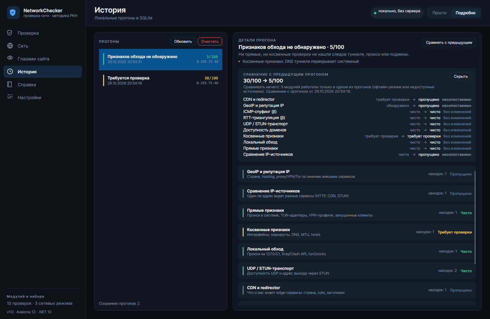 | **Глазами сайта**<br>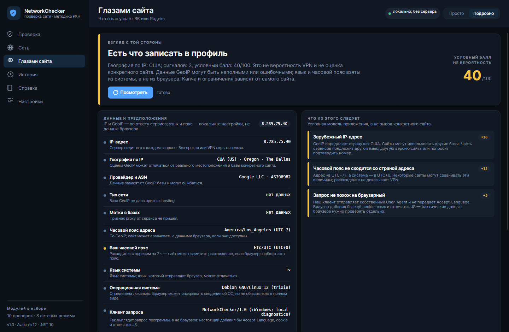 |
| **Справка**<br>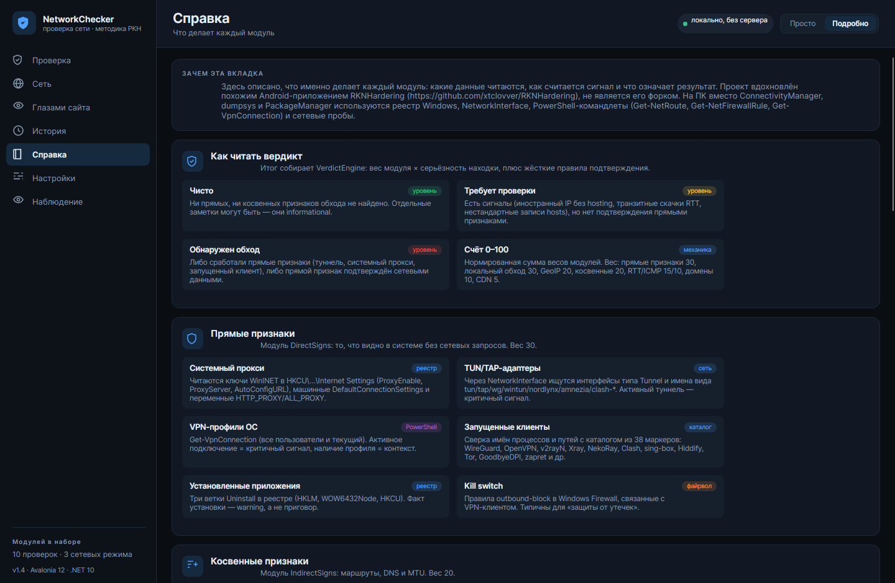 | **Настройки**<br>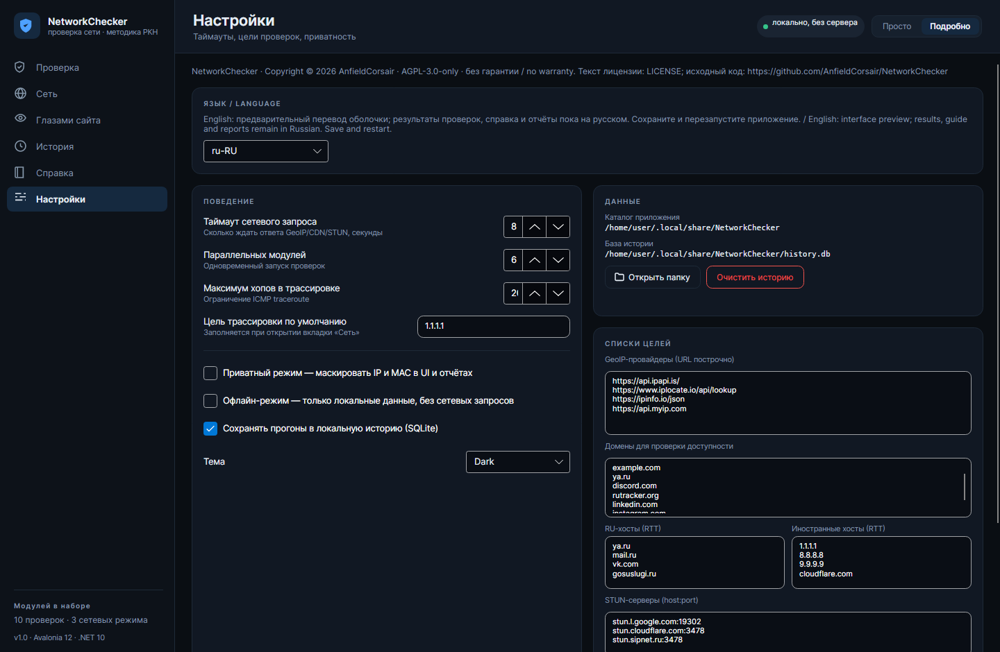 |

Скриншоты снимаются утилитой `tools/NetworkChecker.Screenshots` (headless Avalonia + Skia) из реальных экранов — это не макеты.

---

## Ограничения и честные оговорки

- Проверки читают только то, что видно без прав администратора и без установки драйверов.
- ICMP в сетях с фильтрацией может не работать: тогда RTT-модуль честно переключается на TCP и помечает метод измерения.
- Методика РКН не является «детектором лжи»: наличие признака ≠ доказательство обхода, отсутствие ≠ гарантия чистоты. Поэтому у каждого вывода есть уровень серьёзности и объяснение.
- Windows-специфичные ветки кода собираются на любой ОС, но проверены только статически (среда разработки — Linux CI). Первый запуск на Windows — за вами.

## Roadmap

- [x] WinHTTP-прокси и разбор PAC-скрипта
- [x] HTML-отчёт одним файлом и сравнение прогонов между собой
- [ ] Права администратора: raw ICMP, WMI, WFP, ETW — **отложено по решению от 29.10.2026**, полный разбор в [docs/ADMIN.md](docs/ADMIN.md)
- [ ] WFP-фильтры и ETW-события для детекта перехвата без опроса
- [x] Схема хопов с per-hop ASN-цветом (логическая, без географических координат)
- [ ] Полная локализация интерфейса и результатов на английский (оболочка — предварительный перевод)
- [ ] Подпись сборки и автообновление релизов


## Благодарности

Спасибо автору [RKNHardering](https://github.com/xtclovver/RKNHardering): изначально NetworkChecker задумывался как адаптация похожей идеи для ПК, а затем захотелось развить её дальше, добавив сетевую диагностику, историю и другие возможности.

## Лицензия

Copyright © 2026 AnfieldCorsair. NetworkChecker распространяется по [GNU Affero General Public License v3.0 only](LICENSE) (AGPL-3.0-only), без гарантий. Исходный код: [AnfieldCorsair/NetworkChecker](https://github.com/AnfieldCorsair/NetworkChecker). Сторонние компоненты распространяются на собственных условиях; текст лицензии встроенных шрифтов DejaVu находится в [third-party/DejaVu-LICENSE.txt](third-party/DejaVu-LICENSE.txt). При распространении сборок проверяйте также лицензии остальных зависимостей и выполнение требований AGPL.
