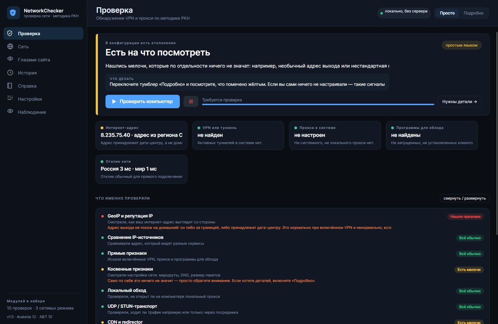
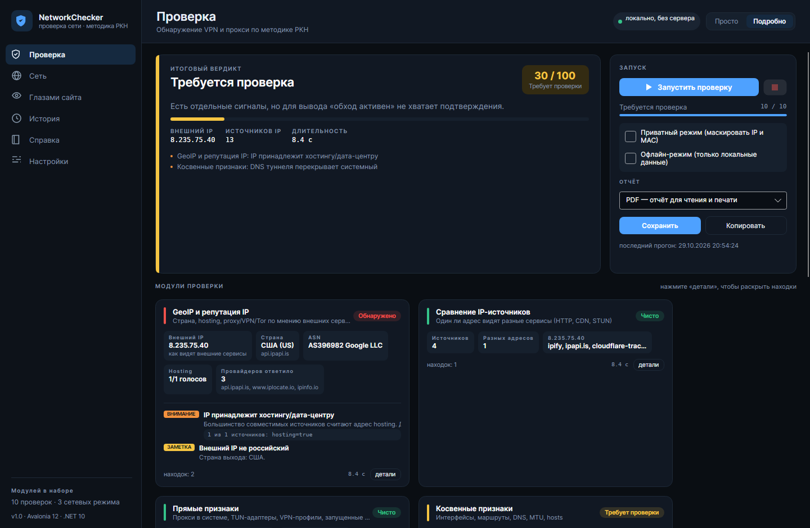
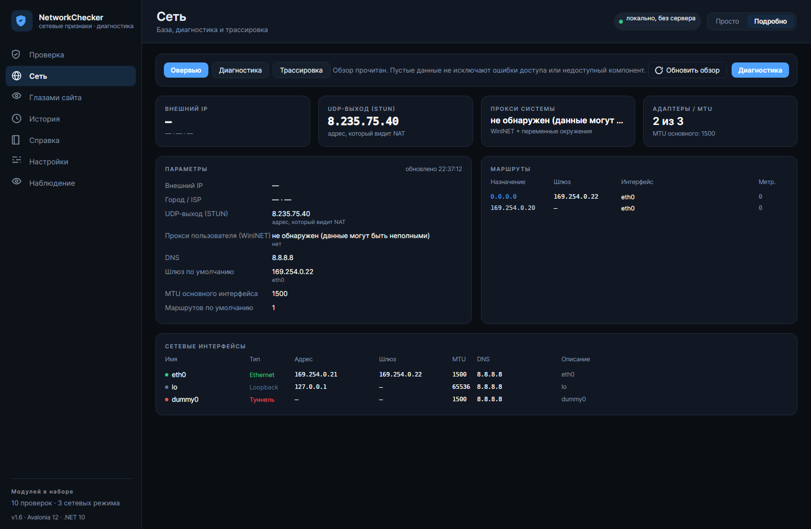
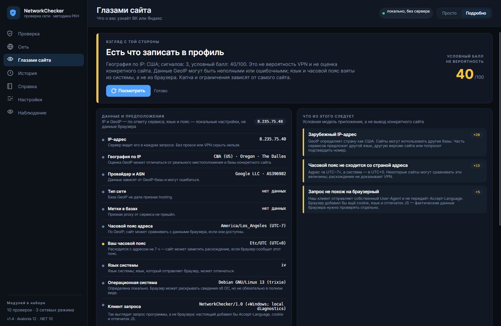

# NetworkChecker

**Windows network diagnostics · Диагностика сети для Windows**  
**v1.6.5** · .NET 10 · AGPL-3.0-only

A Windows desktop app for exploring network configuration, connectivity and possible VPN/proxy indicators. The 0–100 score is a heuristic, **not a probability**.  
Приложение для диагностики сети, соединения и возможных признаков VPN/прокси в Windows. Индекс 0–100 — **условная оценка, не вероятность**.

**[English documentation →](README.en.md)**　|　**[Документация на русском →](README.ru.md)**

| Simple / Просто | Detailed / Подробно |
|:--:|:--:|
|  |  |

| Network / Сеть | Website perspective / Глазами сайта |
|:--:|:--:|
|  |  |

Screenshots show an earlier 1.6 interface; current layout and text may differ. The new Reputation tab is not in them.  
Скриншоты показывают предыдущий вариант интерфейса 1.6; актуальная компоновка и тексты могут отличаться, вкладка «Репутация» в них отсутствует.

[Source code](https://github.com/AnfieldCorsair/NetworkChecker) · [Licence / Лицензия](LICENSE) · [Changelog / История изменений](CHANGELOG.md) · [HTML presentation / Презентация](presentation.html)

### IP reputation & the Google region label / Репутация IP и метка Google

A new **Reputation** tab answers practical questions: is the public IP in spam/DNSBL lists, how many abuse reports it has, what risk scores say, and **which region Google itself assigned** — the `GL` field from YouTube's `ytcfg`. A foreign IP marked `RU` (and the Google AI Studio redirect to the "Available regions" page) is highlighted explicitly. Optional API keys (AbuseIPDB, IPQualityScore, proxycheck.io, ipapi.is, Scamalytics, Spamhaus DQS) stay local; keyless DNSBL + proxycheck work out of the box. There is **no public Google "trust / captcha" API**, so the block shows indirect correlates and says so. Weight 0: the score and `Detected` rules are unchanged. Details: [docs/REPUTATION.md](docs/REPUTATION.md).

Новая вкладка **«Репутация»**: есть ли адрес в спам-базах, сколько жалоб, что говорят риск-скоры и какую метку региона поставил Google (`GL` из `ytcfg` YouTube). Иностранный IP с меткой `RU` и редирект Google AI Studio на страницу доступных регионов подсвечиваются отдельно. Ключи API необязательны и хранятся локально; без ключей работают DNSBL и proxycheck.io. Прямого API «доверия Google» и прогноза капч нет — блок показывает косвенные признаки и честно это оговаривает. Вес 0: индекс и правила `Detected` не изменились. Подробности: [docs/REPUTATION.md](docs/REPUTATION.md).
