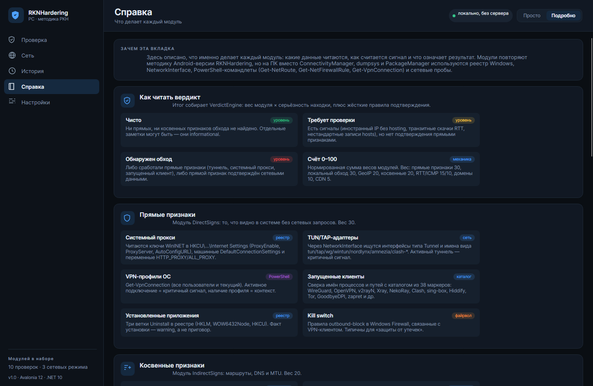
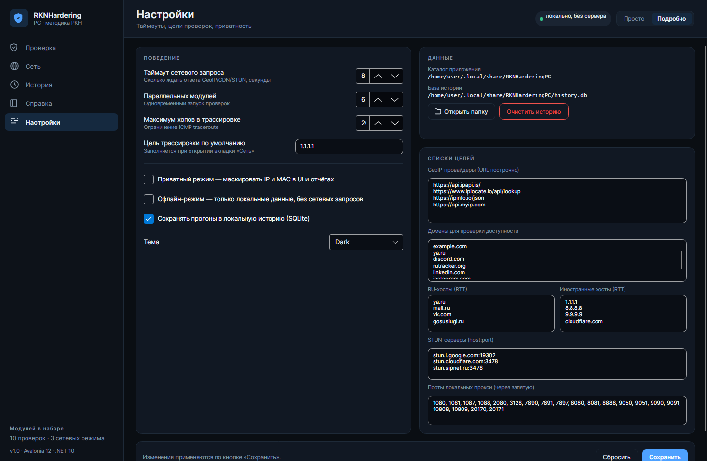

# RKNHardering PC

Приложение для Windows, которое проверяет компьютер по методике РКН: ищет признаки включённого VPN, системного прокси, туннелей и локальных клиентов обхода, а также показывает подробную картину сети.

Самостоятельный проект: свой код, свой UI, свои проверки под Windows. Идею и набор признаков взяли из Android-приложения [RKNHardering](https://github.com/xtclovver/RKNHardering) — оно упомянуто как источник вдохновения, код общий только в смысле методики.

Две аудитории в одном приложении:

- **«Просто»** — понятный ответ для обычного человека: «конфигурация обычная / есть отклонения / есть признаки обхода» + 6 фактов без терминов.
- **«Подробно»** — для тех, кому нужны метрики, находки по каждому модулю, сырые маршруты, DNS, MTU и трассировка.

**Стек:** .NET 10 LTS · Avalonia 12.1.4 · CommunityToolkit.Mvvm 8.4 · EF Core 10 + SQLite · Microsoft.Extensions.Hosting + DI · Serilog.


---

## Два режима интерфейса

Переключатель «Просто / Подробно» — в правом верхнем углу; выбор запоминается в `settings.json`.

| | Просто | Подробно |
|---|---|---|
| Ответ | крупный вердикт человеческим языком + «что делать» | счёт 0–100, причины, наблюдения IP-консенсуса |
| Модули | карточки «что проверяли» со статусом словами | полный список с метриками, находками и доказательствами |
| Сеть | полоса тона + 6 фактов (соединение, VPN/туннель, прокси, адрес выхода, DNS, MTU) | адаптеры, маршруты, NRPT, диагностика, трассировка |
| Настройки | базовое | плюс списки целей: провайдеры GeoIP, домены, STUN, порты |

## Экспорт отчёта

Результат прогона выгружается в привычные форматы — кнопка «Экспорт» на экране проверки:

| Формат | Что получается |
|---|---|
| **PDF** | печатный отчёт: вердикт, находки, таблица модулей, окружение |
| **Word (DOCX)** | тот же отчёт как документ — можно править и дополнять |
| **Excel (XLSX)** | листы «Сводка», «Модули», «Находки», «IP-источники» |
| **CSV** | плоская таблица для своих сводных и скриптов |
| **Markdown** | отчёт для тикета, wiki или git-репозитория |
| **JSON** | полный машинный дамп прогона (для автоматизации и сравнения) |

Кириллица в PDF встроена в файл (шрифт DejaVu, лицензия позволяет), внешние шрифты не нужны.

---

## Что внутри

| # | Модуль | Что делает | Вес |
|---|--------|-----------|-----|
| 1 | **GeoIP и репутация IP** | 4 независимых провайдера, majority vote по `hosting`, «хотя бы один» по `proxy/VPN/Tor`, страна выхода | 20 |
| 2 | **Сравнение IP-источников** | HTTP vs CDN vs STUN: один ли адрес видят разные пути (диагностика) | 0 |
| 3 | **Прямые признаки** | Системный прокси (реестр), TUN/TAP-адаптеры, VPN-профили ОС, запущенные клиенты, установленные приложения, kill switch в файрволе | 30 |
| 4 | **Косвенные признаки** | Маршруты по умолчанию и /32, DNS (loopback, split-DNS/NRPT), MTU туннелей, hosts, виртуальные адаптеры | 20 |
| 5 | **Локальный обход** | Сканирование 21 порта на 127.0.0.1 (SOCKS5/HTTP-прокси), API Xray :10085, Clash/Mihomo :9090-9091 | 30 |
| 6 | **UDP / STUN-транспорт** | STUN binding, сравнение UDP- и TCP-адресов (утечка при проксировании только TCP), доступность MTProto | 10 |
| 7 | **CDN и redirector** | `cdn-cgi/trace`, `httpbin/headers`: страна edge-узла, прокси-заголовки | 5 |
| 8 | **Доступность доменов** | Цепочка DNS → TCP :443 → TLS по набору доменов: где именно ломается доступ | 10 |
| 9 | **RTT-триангуляция (β)** | Медиана задержки до RU-хостов против иностранных, jitter, потери; TCP-fallback, если ICMP заблокирован | 15 |
| 10 | **ICMP-спуфинг (β)** | Сверка ICMP и TCP: разные адреса ответа, «слишком близкий» ответ, ICMP при закрытом TCP | 10 |

Итог собирает `VerdictEngine`: взвешенная сумма `вес × серьёзность` нормируется в 0–100, поверх работают жёсткие правила (прямой `Critical` + подтверждение сетевыми данными → «Обнаружен обход»; расщепление IP-консенсуса → минимум «Требует проверки»).

### Вкладка «Сеть»

- **Овервью** — адаптеры (тип, MTU, MAC, IP, шлюз, DNS), маршруты по умолчанию, системный прокси, внешний IP с ASN/ISP, UDP-выход через STUN.
- **Диагностика** — задержка/jitter/потери по хостам, MTU пути через ICMP с *Don't Fragment*, запросы к каждому системному резолверу и DoH, TLS-сертификаты трёх узлов.
- **Трассировка** — ICMP traceroute (raw-сокет при наличии прав, иначе Ping с нарастающим TTL), до 64 хопов, ASN и оператор через DNS Team Cymru.

### Вкладка «Справка»

Отдельный справочник: как читать вердикт, что делает каждый модуль, какие данные читаются, и таблица соответствия Android-проверок и ПК-аналогов.

---

## Сборка и запуск

Нужен **.NET 10 SDK** (проверено на 10.0.403). Подробный пошаговый гайд для тех, кто собирает впервые, — в [docs/BUILD.md](docs/BUILD.md).

Самый короткий путь (PowerShell в папке проекта):

```powershell
./build.ps1 -Publish
```

Скрипт восстановит пакеты, соберёт, прогонит тесты и положит готовый `RKNHardering.App.exe` в `artifacts/win-x64`.

Вручную:

```powershell
dotnet restore
dotnet build
dotnet test                     # 174 теста во всех четырёх тестовых проектах
dotnet run --project src/RKNHardering.App
```

| Тестовый проект | Что покрывает | Тестов |
|---|---|---|
| `tests/RKNHardering.Core.Tests` | чекеры, вердикт, консенсус IP, парсеры, DNS-wire, plain-язык, раннер | 120 |
| `tests/RKNHardering.Export.Tests` | все шесть форматов отчёта, кириллица, содержимое файлов | 20 |
| `tests/RKNHardering.App.Tests` | ViewModel'и, режимы UI, навигация, рендер всех экранов (headless) | 23 |
| `tests/RKNHardering.Data.Tests` | история прогонов (EF Core/SQLite), settings.json | 11 |

Публикация:

```powershell
./build.ps1                       # Debug + тесты
./build.ps1 -Publish              # framework-dependent → artifacts/win-x64
./build.ps1 -Publish -SelfContained   # .NET не нужен на целевой машине
```

### Требования к ОС

Полный набор проверок — Windows 10/11:

- реестр (прокси, Uninstall, DRL/службы) — `Microsoft.Win32.Registry`;
- сетевые командлеты — `Get-NetRoute`, `Get-NetAdapter`, `Get-NetFirewallRule`, `Get-VpnConnection`;
- WinINET-настройки пользователя и машинные `DefaultConnectionSettings`.

На Linux/macOS проект собирается и запускается, но платформенный слой возвращает пустые значения (интерфейсы, маршруты, DNS читаются кроссплатформенно) — работают сетевые модули, остальное честно уходит в «Пропущено»/«Ошибка».

### Права администратора

Не обязательны. Без них недоступны: raw-ICMP-трассировка (используется fallback через `Ping`), часть данных некоторых служб и правила файрвола других пользователей.

---

## Где лежат данные

`%LOCALAPPDATA%\RKNHarderingPC\`

| Файл | Что внутри |
|------|-----------|
| `settings.json` | настройки и списки целей (провайдеры, домены, STUN, порты) |
| `history.db` | история прогонов (SQLite, EF Core) |
| `logs\app-YYYYMMDD.log` | журнал Serilog, 7 дней |

Сервера нет: вся история и настройки — локальные файлы. Приватный режим маскирует IP/MAC в UI и в экспорте, офлайн-режим отключает все внешние запросы.

---

## Структура решения

```text
src/
├── RKNHardering.Core            # модели, чекеры, вердикт, сетевые примитивы, экспорт
│   ├── Abstractions/            # ICheck, IPlatformProbe, IHttpProbe, CheckContext
│   ├── Checks/                  # 10 модулей проверки
│   ├── Verdict/                 # VerdictEngine, IpConsensusBuilder
│   ├── Net/                     # HTTP, DNS wire, TCP/TLS, STUN, ICMP, трассировка, ASN
│   ├── NetInfo/                 # сервис вкладки «Сеть» (обзор/диагностика/трасса)
│   └── Export/                  # Markdown и JSON-отчёты
├── RKNHardering.Platform.Windows # IPlatformProbe: реестр, PowerShell, сеть, hosts
├── RKNHardering.Data            # EF Core + SQLite, история, settings.json
├── RKNHardering.Export          # PDF / DOCX / XLSX / CSV / Markdown / JSON
└── RKNHardering.App             # Avalonia UI (MVVM, 5 экранов, два режима)
tests/
├── RKNHardering.TestKit         # общие фейки: платформа, HTTP, чекеры, «эталонные» прогоны
├── RKNHardering.Core.Tests
├── RKNHardering.Export.Tests
├── RKNHardering.App.Tests       # включая headless-рендер экранов
└── RKNHardering.Data.Tests
tools/RKNHardering.Screenshots   # рендер реальных экранов в PNG (для ревью UI)
```

Поток данных: `DashboardViewModel` → `CheckRunner` (параллельно, `MaxParallelChecks`) → `ICheck.RunAsync` → `VerdictEngine` + `IpConsensusBuilder` → `HistoryRepository` → UI/экспорт.

### Как добавить свою проверку

1. Реализовать `ICheck` в `Core/Checks` (категория, вес, `RunAsync`).
2. Зарегистрировать в `AppServices.Build`: `services.AddSingleton<ICheck, MyCheck>();`
3. Задать вес в `VerdictEngine.SeverityFactor`, если нужен нестандартный коэффициент.
4. Добавить описание в `GuideViewModel` (вкладка «Справка»).
5. Покрыть логику тестом в `tests/RKNHardering.Core.Tests`.

---

## Соответствие Android-версии

| Android (RKNHardering) | ПК-реализация |
|---|---|
| `ConnectivityManager` / `TRANSPORT_VPN` | реестр WinINET + перечисление адаптеров `NetworkInterface` |
| `VpnService`, `dumpsys vpn_management` | TUN/TAP-адаптеры, `Get-VpnConnection`, службы/драйверы |
| `PackageManager` (список пакетов) | три ветки `Uninstall` в реестре |
| `NetworkInterface.getNetworkInterfaces()` | `NetworkInterface` + `Get-NetAdapter` |
| `/proc/net/route` | `Get-NetRoute` (fallback: `/proc/net/route` на Linux) |
| Private DNS / split DNS | `DnsAddresses`, NRPT (`DnsPolicyConfig`) |
| `BypassChecker` (localhost proxy) | тот же подход + API Xray/Clash |
| `NativeSignsChecker` (JNI) | нативные Windows API: реестр, файрвол, PowerShell |
| `RttTriangulationChecker` (SNITCH β) | ICMP + TCP-fallback |
| `LocationSignalsChecker` (MCC/SIM/BeaconDB) | не переносится (нет сотового модуля), частично закрыто GeoIP |

---

## Скриншоты

| | |
|---|---|
| **Простой режим, до запуска**<br> | **Простой режим, результат**<br> |
| **Подробный режим, результат**<br> | **Сеть в простом режиме**<br> |
| **Сеть: овервью**<br> | **Сеть: диагностика**<br> |
| **Сеть: трассировка**<br> | **История**<br> |
| **Справка**<br> | **Настройки**<br> |

Скриншоты снимаются утилитой `tools/RKNHardering.Screenshots` (headless Avalonia + Skia) из реальных экранов — это не макеты.

---

## Ограничения и честные оговорки

- Проверки читают только то, что видно без прав администратора и без установки драйверов.
- ICMP в сетях с фильтрацией может не работать: тогда RTT-модуль честно переключается на TCP и помечает метод измерения.
- Методика РКН не является «детектором лжи»: наличие признака ≠ доказательство обхода, отсутствие ≠ гарантия чистоты. Поэтому у каждого вывода есть уровень серьёзности и объяснение.
- Windows-специфичные ветки кода собираются на любой ОС, но проверены только статически (среда разработки — Linux CI). Первый запуск на Windows — за вами.

## Roadmap

- [ ] WinHTTP-прокси (`netsh winhttp show proxy`) и PAC-разбор
- [ ] WFP-фильтры и ETW-события для детекта перехвата без опроса
- [ ] HTML-отчёт (для отправки одним файлом) и сравнение прогонов между собой
- [ ] ICMP raw с авто-повышением прав
- [ ] Трей-граф с картой хопов и per-hop ASN-цветом
- [ ] Локализация интерфейса (en)
