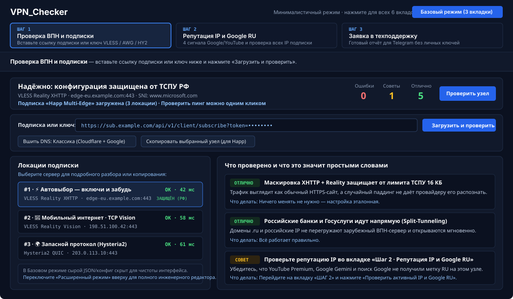
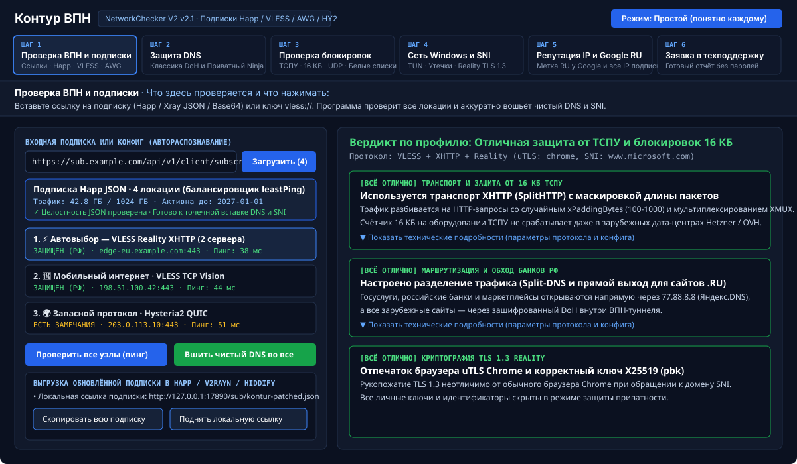
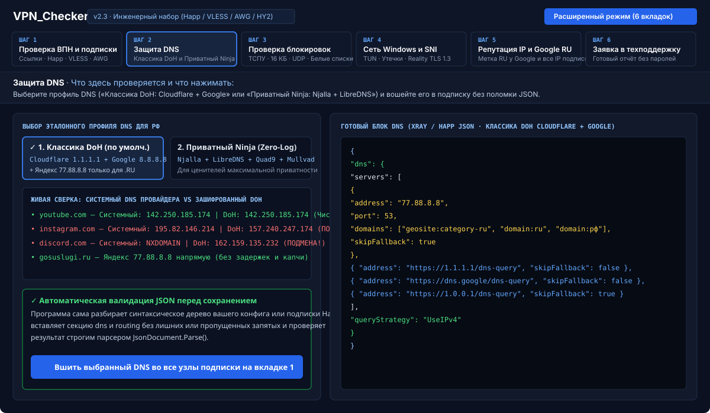
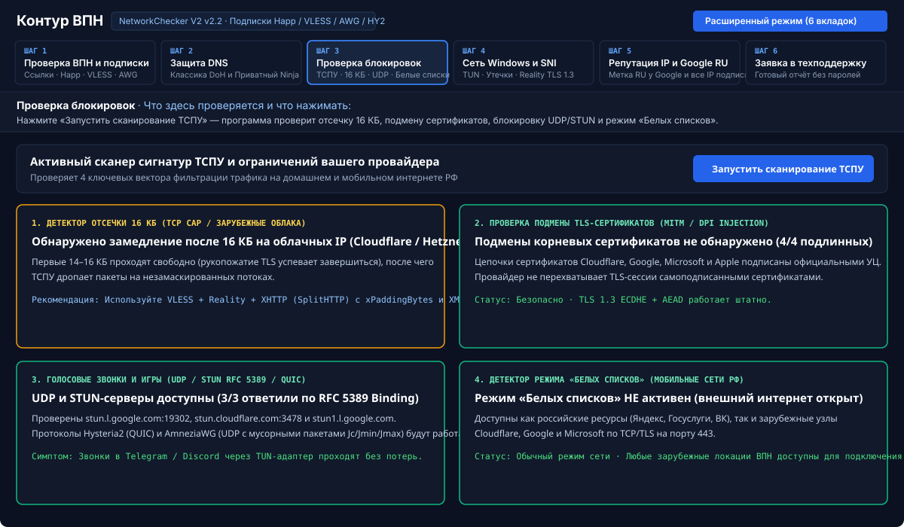
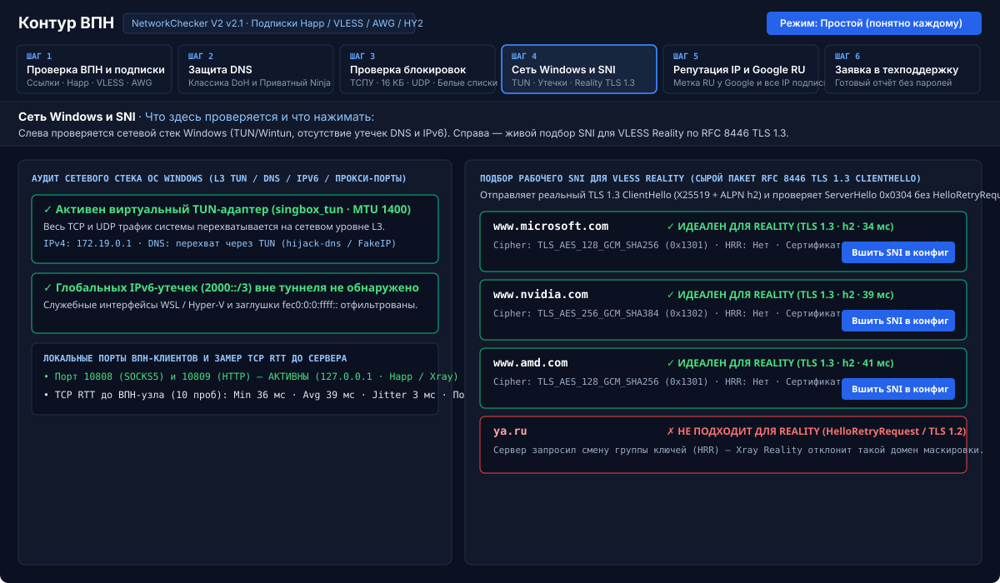
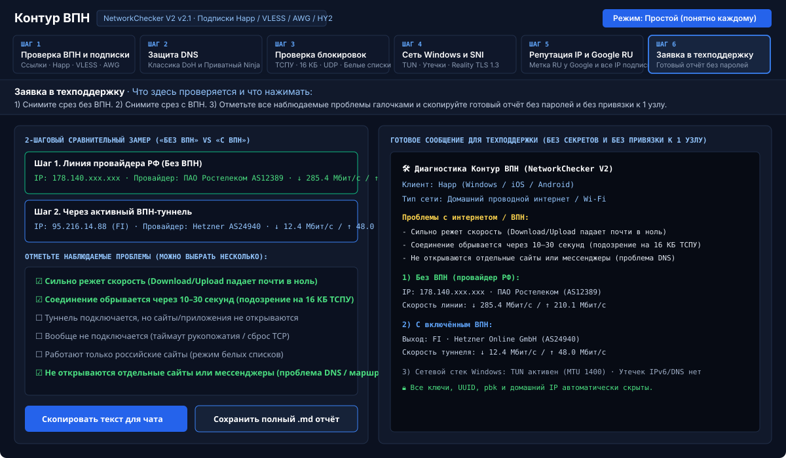

<div align="center">

# 🛡️ Kontur VPN — NetworkChecker V2

**Windows Desktop Diagnostics Suite for VPN Configs, Subscriptions, DPI/TSPU Fingerprints & Google `RU` Geo-Poisoning Detection**

[](https://dotnet.microsoft.com/)
[](https://learn.microsoft.com/dotnet/csharp/)
[](https://avaloniaui.net/)
[](https://github.com/AnfieldCorsair/NetworkChecker/tree/Version-2.0)

**English (README.md)** · [Русский README](README.ru.md)

</div>

---

## Overview

**Kontur VPN (NetworkChecker V2)** is a standalone **.NET 10 / Avalonia UI 12** desktop application for Windows designed to audit VPN subscriptions, diagnose ISP/DPI interference, inspect Windows TUN/IPv6 leaks, and detect Google `RU` geo-poisoning on foreign VPN nodes.

The interface provides **two switchable modes** right from the top bar:

- **Basic Mode (default · 3 tabs)** — clean, distraction-free workspace for everyday checks:
  1. **VPN & Subscription Audit** — single input for subscription URLs (`https://`) or direct keys (`vless://`, `hy2://`, `trojan://`, `vmess://`, `ss://`, AmneziaWG), node selector, one-click reachability test, and plain-language verdicts.
  2. **IP Reputation & Google `RU`** — 4-signal Google/YouTube geo-poisoning probe and batch reputation scanner for every server inside your subscription.
  3. **Support Ticket Generator** — two-step *Without VPN / With VPN* capture and masked report ready for Telegram support.
- **Advanced Mode (6 tabs)** — unlocks the full engineering suite: raw JSON/URI editor, presets, local `127.0.0.1` subscription hosting, DNS Architect (`DoH`/`DoT` injection), DPI/TSPU fingerprint tests (16 KB cutoff / UDP / whitelists), Windows network stack audit (`TUN` / `IPv6` / `MTU`), and `/24` Reality SNI scanner with live TLS 1.3 handshake verification.

---

## 🖼️ Interface Previews

### Minimalist Basic Mode (Default Startup · 3 Tabs)

> Clean workspace with zero raw-config clutter: paste a subscription URL or VPN key, pick a node, inspect verdicts, and check Google `RU` reputation.



---

### Advanced Mode (Full 6-Tab Engineering Suite)

#### 1. VPN & Subscription Audit (Happ / Xray JSON / VLESS / AWG / Hysteria2)


#### 2. DNS Protection Architect (Classic DoH / Private Ninja + Config Injection)


#### 3. DPI / TSPU Blocking Fingerprints (16 KB Cutoff, UDP Calls, DNS Spoofing, Whitelists)


#### 4. Windows Network Stack (TUN / IPv6 / MTU) & Reality SNI Hunter (TLS 1.3)


#### 5. IP Reputation, 4-Signal Google `RU` Detector & Batch Subscription IP Audit


#### 6. Support Ticket Builder (Telegram Report with Automatic Secret Masking)


---

## 🎯 How the 4-Signal Google `RU` Geo-Poisoning Probe Works (v2.2)

Foreign VPS subnets heavily used by VPN clients often get re-tagged as **Russia (`RU`)** inside Google's internal geo database due to mobile Wi-Fi/GPS telemetry. Even when GeoIP databases report `NL`, `DE`, or `FI`, **Google Gemini** blocks access, **YouTube Premium** becomes unavailable, and Search may trigger `/sorry/` captchas.

In **v2.2**, the Google detection engine uses:

- **EU Consent Wall Bypass**: attaches `SOCS` + `CONSENT` cookies and a desktop Chrome `User-Agent` to prevent European exit nodes (`DE`, `NL`, `FI`, `PL`) from redirecting to `consent.google.com`.
- **4 Parallel Independent Signals**:
  1. **YouTube `INNERTUBE_CONTEXT_GL`** — parses `youtube.com/sw.js_data` (both keyed and positional arrays) with `youtube.com/?hl=en` fallback.
  2. **YouTube Premium Availability** — checks `youtube.com/premium?hl=en` for *"not available in your country"* vs normal regional offers.
  3. **Google Gemini / AI Access** — probes `gemini.google.com/app?hl=en` for `/unsupported` redirects, HTTP `403`/`451`, and regional blocks.
  4. **Google Search Region & `/sorry/` Captcha** — extracts the footer country (`<div class="uU7dJb">...</div>`), checks `google.ru` redirects, and detects `HTTP 429` `/sorry/` reCAPTCHA blocks.
- **4-Provider GeoIP Consensus** (`ipwho.is`, `ip-api.com`, `ipinfo.io`, `Cloudflare Trace`):
  - **Hosting / Datacenter**: Majority Vote (≥ 50% of reporting providers).
  - **Proxy / VPN / Tor**: Strict Any-Vote detection.
  - **HTTP vs CDN IP Consistency**: Detects split-routing discrepancies.
- **Batch Subscription IP Scanner**: extracts every server from Happ JSON arrays, Xray configs, or URI lists, resolves domains to IPv4/IPv6, and evaluates ASN hosting/proxy status, Google `RU` bleed risk, and DPI 16 KB cloud risk.
- **3 Routing Modes** (in Advanced Mode):
  1. Active OS Internet / TUN Adapter.
  2. Auto-detect Local VPN Client Proxy (`10809`, `10808`, `2080`, `7890`, `1080`).
  3. Manual IP / Hostname Lookup without toggling your VPN.

---

## 🏗️ Project Structure

```text
NetworkChecker.slnx
├── Directory.Build.props                # .NET 10, C# 14, TreatWarningsAsErrors=true, AnalysisMode=Recommended
├── src/
│   ├── NetworkChecker.Core/             # Pure C# diagnostics core (zero UI dependencies)
│   │   └── VpnAudit/
│   │       ├── VpnConfigParser.cs       # VLESS / XHTTP / Vision / AWG / Hysteria2 / Happ JSON parser
│   │       ├── VpnConfigAuditor.cs      # Audit rules & one-click patchers
│   │       ├── IpReputationProbe.cs     # 4 GeoIP consensus + 4-signal Google RU probe + batch IP scanner
│   │       ├── SubscriptionService.cs   # Subscription fetcher, traffic metadata, local 127.0.0.1 host
│   │       ├── BlockingFingerprintDetector.cs  # 16 KB cutoff, UDP, DNS spoofing, whitelist detector
│   │       ├── WindowsNetworkStackAuditor.cs   # Windows adapter audit (TUN, IPv6, MTU, local proxy ports)
│   │       ├── SubnetSniScanner.cs      # /24 Reality SNI hunter with live TLS 1.3 ServerHello check
│   │       └── SupportTicketBuilder.cs  # Masked Telegram & Markdown support report generator
│   └── NetworkChecker.App/              # Avalonia 12.1.4 + CommunityToolkit.Mvvm (Basic & Advanced UI)
└── tests/
    └── NetworkChecker.Core.Tests/       # xUnit test suite (parsers, Google RU signals, DPI, Windows stack)
```

---

## 🚀 Build & Run (Windows)

Requires [.NET 10 SDK](https://dotnet.microsoft.com/download/dotnet/10.0) on Windows 10/11 x64.

```powershell
# 1. Clone the Version-2.0 branch
git clone -b Version-2.0 https://github.com/AnfieldCorsair/NetworkChecker.git
cd NetworkChecker

# 2. Build (TreatWarningsAsErrors enabled — 0 warnings)
dotnet build NetworkChecker.slnx -c Release

# 3. Run unit tests
dotnet test NetworkChecker.slnx -c Release

# 4. Launch desktop app
dotnet run --project src/NetworkChecker.App -c Release
```

### Publish Self-Contained Single-File EXE

```powershell
dotnet publish src/NetworkChecker.App/NetworkChecker.App.csproj `
  -c Release -r win-x64 --self-contained true `
  -p:PublishSingleFile=true -p:IncludeNativeLibrariesForSelfExtract=true
```

---

## 🔒 Privacy & Safety

- All diagnostics run locally from your machine with no telemetry servers.
- UUIDs, AmneziaWG/Reality private keys, passwords, and home IP suffixes are masked automatically in generated support tickets.
- Targeted DNS injection preserves every server endpoint, key, and routing rule intact.
