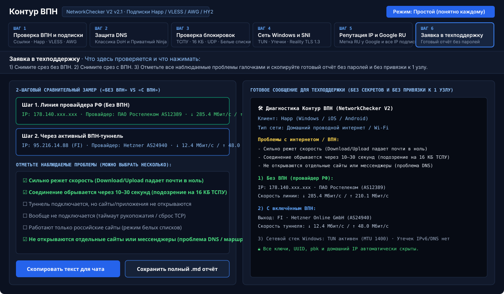

<div align="center">

# Контур ВПН (NetworkChecker V2 v2.1.0)

**Глубокий аудит ВПН-подписок (Happ / Xray JSON / VLESS Reality XHTTP / AmneziaWG / Hysteria2), детектор отсечки 16 КБ на ТСПУ, подбор SNI сырым пакетом RFC 8446 TLS 1.3 и проверка репутации IP + «прокажённой метки RU» у Google**

[](https://dotnet.microsoft.com/)
[](https://learn.microsoft.com/dotnet/csharp/)
[](https://avaloniaui.net/)
[](https://github.com/AnfieldCorsair/NetworkChecker)
[](https://opensource.org/licenses/MIT)

**[English Overview (README.md) →](./README.md)**

</div>

---

## О проекте

**Контур ВПН (NetworkChecker V2)** — это настольный и веб-комплекс диагностики ВПН-соединений, созданный специально под актуальные реалии фильтрации трафика в РФ:
- **Аудит и безопасное улучшение подписок** (**Happ**, **v2rayN**, **Sing-box**, **Hiddify**, **NekoBox**, **AmneziaVPN**): программа сама скачивает подписку по `https://`-ссылке, разбирает сложные JSON-массивы с балансировщиками (`leastPing`), проверяет все локации и аккуратно вшивает чистый DNS или рабочий SNI без поломки синтаксиса JSON.
- **Простой и Инженерный режимы**: по умолчанию включён понятный каждому *«Простой режим»* с верхней поясняющей плашкой на каждой вкладке, а все низкоуровневые параметры протоколов спрятаны под разворачиваемыми спойлерами.
- **Проверка репутации IP и «прокажённой метки RU» у Google / YouTube**: развивает идею оригинального `NetworkChecker` (консенсус 4 независимых GeoIP-баз по правилам *Majority Vote* и *Any Vote*) и дополняет её живым детектором `INNERTUBE_CONTEXT_GL` у YouTube/Google, а также пакетным сканером сразу всех IP-адресов внутри вашей подписки.


---

## Обзор всех 6 вкладок программы

### ШАГ 1. Проверка ВПН и подписки (`Happ / Xray JSON / VLESS / AmneziaWG / Hysteria2`)


- **Умное автораспознавание входа**: вставьте прямую `https://`-ссылку на подписку, Base64-список, JSON-массив Happ/Xray или одиночный ключ `vless://`, `hy2://`, `trojan://`, `vmess://`, `ss://`, `AmneziaWG`.
- **Карточка подписки**: отображает название сервиса, остаток трафика (`subscription-userinfo`), срок действия и список всех узлов с возможностью пинга всех серверов в один клик.
- **Глубокий аудит защиты под РФ**:
  - проверка транспорта на устойчивость к **отсечке 16 КБ ТСПУ** (`XHTTP / SplitHTTP` с `xPaddingBytes` и `xmux`, `VLESS TCP xtls-rprx-vision`, `AmneziaWG Jc/Jmin/Jmax/S1/S2/H1..H4`, `Hysteria2 Salamander`);
  - проверка криптографии **TLS 1.3 Reality** (`uTLS fingerprint`, корректность X25519 `pbk`, `shortId`, отсутствие `allowInsecure=1` и IP-адреса в поле SNI);
  - проверка маршрутизации сайтов `.RU` и российских банков напрямую (`geosite:category-ru`, `geoip:ru`).
- **Локальная ссылка подписки**: встроенный HTTP-сервер поднимает локальную ссылку вида `http://127.0.0.1:17890/sub/kontur-patched.json`, которую можно вставить прямо в Happ или v2rayN.

---

### ШАГ 2. Защита DNS и безопасная интеграция в JSON


- **Живая проверка DNS-спуфинга**: параллельно сравнивает ответы системного DNS вашего провайдера с зашифрованным DoH, мгновенно выявляя подмену IP-адресов или заглушки `NXDOMAIN`.
- **Два эталонных профиля DNS под рукой**:
  1. **Классика DoH (по умолчанию)** — `Cloudflare (https://1.1.1.1/dns-query)` + `Google (https://dns.google/dns-query)` для зарубежных ресурсов и `Яндекс.DNS (77.88.8.8)` строго для доменов `.ru / .рф / geosite:category-ru` со стратегией `UseIPv4`.
  2. **Приватный Ninja (Zero-Log)** — `Njalla (https://dns.njal.la/dns-query)` + `LibreDNS (https://doh.libredns.gr/dns-query)` + `Quad9` + `Mullvad` для ценителей максимальной приватности без логирования.
- **Гарантия целостности JSON (без сломанных запятых)**:
  - вставка DNS никогда не использует хрупкую склейку строк: программа модифицирует AST-дерево (`JsonNode`), автоматически адаптируется под одиночный конфиг Xray, Sing-box или мульти-профильный JSON-массив Happ и выполняет строгую пост-проверку через `JsonDocument.Parse` (`AllowTrailingCommas = false`).
  - кнопка **«Скопировать блок DNS»** копирует чистый, валидный JSON-объект `{ "dns": { ... } }`, а кнопка **«Вшить в конфиг на вкладке 1»** автоматически обновляет всю подписку целиком.

---

### ШАГ 3. Проверка блокировок провайдера (ТСПУ и 16 КБ)


Четыре специализированных сетевых зонда для диагностики линии провайдера:
1. **Детектор отсечки 16 КБ (TCP 16 KB Cap)**: проверяет, не обрывает ли ТСПУ передачу данных после первых 14–16 КБ при обращении к зарубежным дата-центрам (Cloudflare / Hetzner / OVH).
2. **Проверка подмены TLS-сертификатов (MITM)**: сверяет цепочки сертификатов зарубежных узлов с системным хранилищем корневых УЦ, выявляя DPI-перехват.
3. **Голосовые звонки и игры (UDP / STUN RFC 5389)**: отправляет реальные UDP Binding Request к `stun.l.google.com:19302` и `stun.cloudflare.com:3478`, проверяя работоспособность звонков в Telegram/Discord и протоколов `Hysteria2` / `AmneziaWG`.
4. **Детектор режима «Белых списков»**: сопоставляет доступность российских ресурсов и зарубежного интернета на мобильных сетях.

---

### ШАГ 4. Сеть Windows и подбор SNI для VLESS Reality


- **Нативный аудит сетевого стека Windows**:
  - проверяет наличие активного виртуального интерфейса **Wintun / Sing-box TUN / WireGuard / AmneziaWG** и его `MTU` (рекомендуемый диапазон `1280–1400`);
  - отфильтровывает служебный шум (`WSL`, `Hyper-V`, `Bluetooth`, фиктивные заглушки `fec0:0:0:ffff::1..3`);
  - выявляет утечки провайдерского DNS мимо TUN (SMHNR) и глобальные маршрутизируемые IPv6-адреса (`2000::/3`) вне туннеля;
  - сканирует локальные порты прокси-клиентов (`10808`, `10809`, `2080`, `7890`, `1080`).
- **Эталонный подбор SNI для VLESS Reality (`SniHunterProbe`)**:
  - вместо обычного `SslStream`, который может молча откатиться на TLS 1.2 или согласиться на `HelloRetryRequest`, зонд отправляет **сырой пакет RFC 8446 TLS 1.3 ClientHello** (только `TLS 1.3 0x0304`, `X25519 key_share`, `ALPN h2`) и побайтово разбирает `ServerHello`;
  - домен помечается как **«Идеален для Reality»** только если сервер согласовал чистый `TLS 1.3 (0x0304)` за один раунд без `HelloRetryRequest`, вернул валидный сертификат для целевого хоста и поддерживает `ALPN h2`;
  - точечная вставка SNI обновляет `realitySettings.serverName` во всех `outbounds` подписки, не затирая кастомный `xhttpSettings.host`.

---

### ШАГ 5. Репутация IP, детектор «прокажённой метки RU» у Google и аудит всех IP подписки


#### 1. Детектор «прокажённой метки RU» у Google и YouTube
Почему зарубежный ВПН-сервер в Нидерландах или Германии внезапно открывает YouTube с российскими ограничениями, не пускает в **Google Gemini / AI Studio** и требует бесконечную капчу?
- Когда сотни пользователей со смартфонами из РФ подключаются к одному IP зарубежного хостера (особенно `Aeza`, `PQ.Hosting / Stark Industries`, `Timeweb` и др.), сервисы Google Location Services сопоставляют BSSID российских точек Wi-Fi и GPS-координаты с этим выходным IP и **принудительно привязывают всю зарубежную подсеть к региону `RU`**.
- Во всех стандартных базах (`MaxMind`, `ipinfo`, `ipwho.is`) сервер продолжает числиться как `NL` или `DE`, но внутри Google он уже помечен как `RU`.
- **Как программа это проверяет**:
  - поддерживает 3 режима: **«1. Активный интернет / TUN-адаптер»**, **«2. Авто-прокси запущенного клиента ВПН (порты 10809/10808/2080/7890)»** и **«3. Ручная проверка любого IP или домена»**;
  - выполняет прямой запрос к `youtube.com/sw.js_data` и `google.com/preferences?hl=en`, извлекая внутренний параметр Google **`INNERTUBE_CONTEXT_GL`** и проверяя наличие редиректа на `/sorry/index` (`HTTP 429`);
  - если физическая страна по консенсусу GeoIP ≠ `RU`, а Google возвращает `GL = "RU"`, программа выдаёт красный вердикт **«КРИТИЧНО: Обнаружена прокажённая метка RU у Google»** с рекомендацией сменить узел или направить `geosite:google` через чистую локацию.

#### 2. Консенсус 4 независимых GeoIP-баз
Параллельно опрашивает `ipwho.is`, `ip-api.com`, `ipinfo.io` и `Cloudflare Trace` (`1.1.1.1/cdn-cgi/trace`):
- **Hosting / Дата-центр (Majority Vote `>= 50%`)**: IP признаётся дата-центром только при согласии большинства баз.
- **Proxy / VPN / Tor (Any Vote `хотя бы один`)**: предупреждает о риске капчи, если хотя бы одна база пометила IP как прокси.
- **Сверка видимого IP (HTTP vs CDN)**: проверяет, не расходятся ли выходные IP при обращении к обычным сайтам и к сети Cloudflare.

#### 3. Пакетная проверка сразу всех IP внутри подписки («Все IP из вашей подписки»)
- Одним нажатием извлекает все серверы из подписки на вкладке 1 (включая все `outbounds` внутри JSON-балансировщиков Happ/Xray, все ссылки `vless://`, `hy2://`, `trojan://`, `vmess://`, `ss://`, `AmneziaWG`).
- Параллельно резолвит доменные имена серверов в реальные IPv4/IPv6-адреса.
- Пакетно проверяет страну, `ASN / ISP`, флаги `Hosting / Proxy`, **риск метки RU у Google** и **риск ТСПУ 16 КБ**, позволяя за 2 секунды выбрать самый чистый сервер из десятков локаций.

---

### ШАГ 6. 2-шаговый генератор заявки в техподдержку



- **Сравнительный замер в 2 клика**:
  - *Шаг 1 (Без ВПН)* — фиксирует вашего РФ-провайдера, ASN и базовую скорость линии;
  - *Шаг 2 (С ВПН)* — фиксирует выходной ASN туннеля и реальную скорость через ВПН.
- **Мультивыбор проблем с интернетом**: можно отметить сразу несколько симптомов галочками (например, падение скорости + обрыв после 16 КБ + проблемы с DNS).
- **Без привязки к одному случайному серверу и без утечки секретов**: отчёт не засоряется параметрами одного конкретного узла из большой подписки, а все пароли, `UUID`, `pbk` и последние октеты домашнего IP автоматически скрываются (`xxx.xxx`).

---

## Сборка и запуск C# Desktop (`.NET 10 / Avalonia 12.1.4`)

### Требования
- **.NET 10 SDK** (`10.0.100` или новее)
- ОС: **Windows 10 / 11 (x64)** (также собирается и проходит все тесты на Linux и macOS)

### Запуск тестов и приложения из исходников

```bash
cd desktop-cs
dotnet test NetworkChecker.slnx
dotnet run --project src/NetworkChecker.App/NetworkChecker.App.csproj
```

### Сборка автономного `.exe` (Single-File без необходимости ставить .NET)

```bash
cd desktop-cs
dotnet publish src/NetworkChecker.App/NetworkChecker.App.csproj \
  -c Release -r win-x64 --self-contained true \
  -p:PublishSingleFile=true \
  -p:IncludeNativeLibrariesForSelfExtract=true
```

Готовый исполняемый файл появится в папке `.cache/bin/NetworkChecker.App/Release/net10.0/win-x64/publish/NetworkChecker.exe`.
