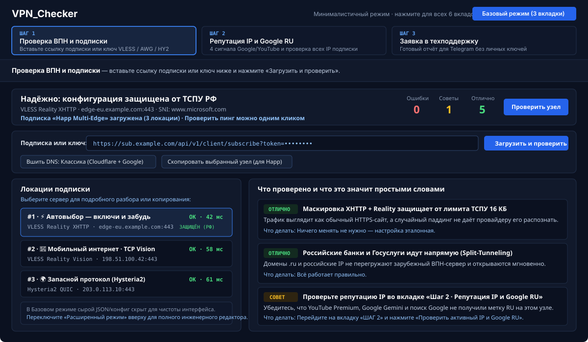
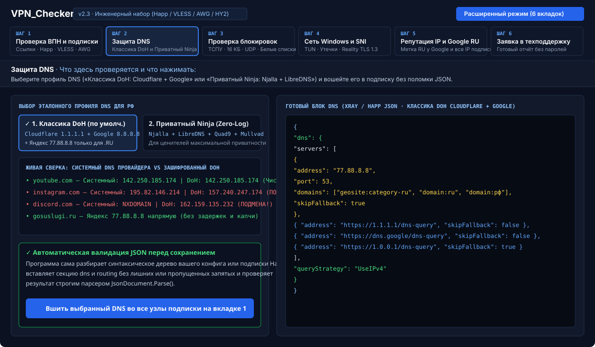
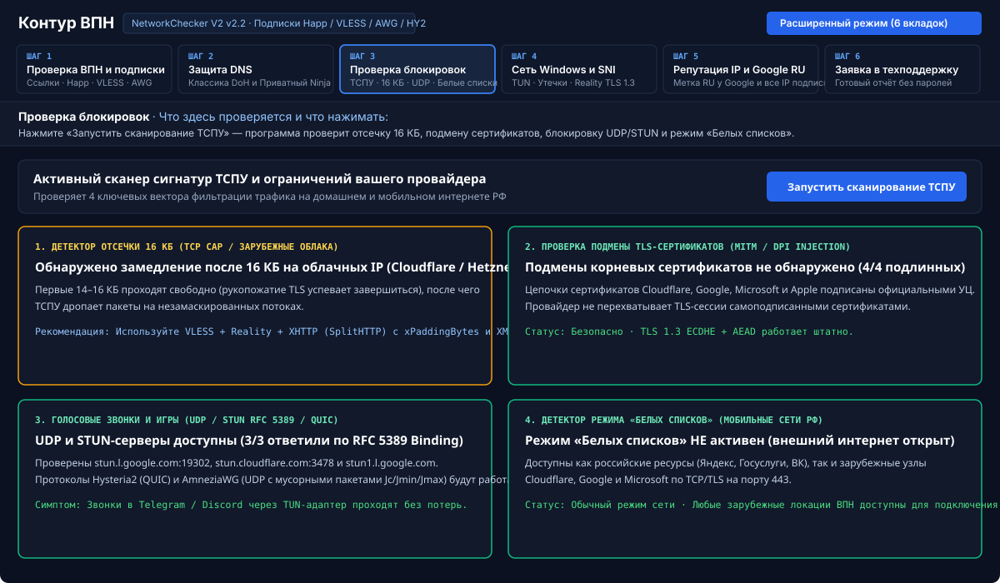
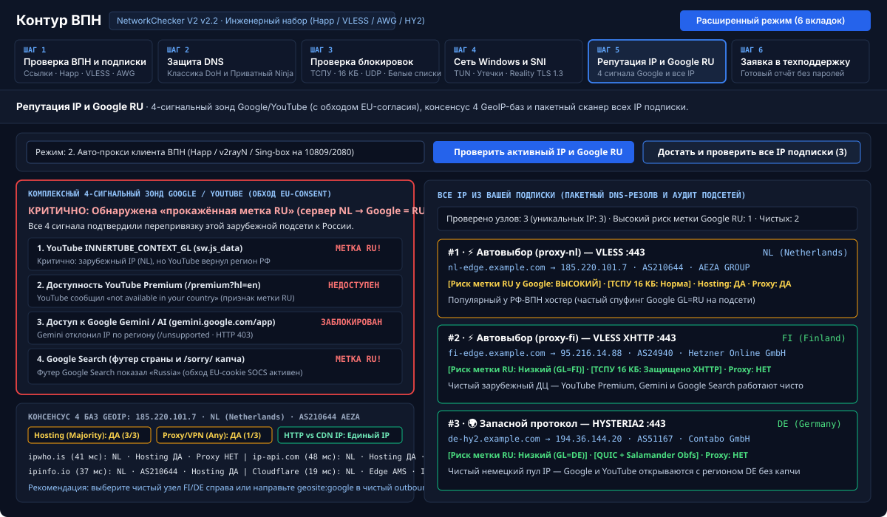

<div align="center">

# 🛡️ VPN_Checker

**Настольная утилита диагностики ВПН, подписок, ТСПУ-блокировок, «прокажённой метки RU» у Google и доступа к AI Studio / Gemini для Windows**

[](https://dotnet.microsoft.com/)
[](https://learn.microsoft.com/dotnet/csharp/)
[](https://avaloniaui.net/)
[](https://github.com/AnfieldCorsair/VPN_Checker)
[](LICENSE)

[English README](README.md) · **Русский (README.ru.md)**

</div>

---

## О проекте

**VPN_Checker** — автономное Windows-приложение на **.NET 10 / Avalonia UI 12**, созданное для быстрой и понятной диагностики современных ВПН-подключений в условиях ТСПУ РФ.

Приложение работает в **двух режимах**, переключаемых одной кнопкой в верхней панели:

- **Базовый режим (по умолчанию · 3 вкладки)** — минималистичный интерфейс без инженерного шума:
  1. **Проверка ВПН и подписки** — одно поле для ссылки подписки (`https://`) или ключа (`vless://`, `hy2://`, `trojan://`, `vmess://`, `ss://`, AmneziaWG), выбор локации, проверка доступности и разбор простыми словами.
  2. **Репутация IP и Google RU** — 6-сигнальный живой детектор метки RU (с отдельными бейджами **Google AI Studio** и **Gemini**) + пакетный аудит всех IP подписки через **RIPE/RDAP WHOIS** и честную 4-уровневую шкалу риска.
  3. **Заявка в техподдержку** — сбор срезов «Без ВПН / С ВПН» и готовый безопасный отчёт для Telegram без утечки ключей и домашнего IP.
- **Расширенный режим (6 вкладок)** — открывает полный инженерный инструментарий: редактор сырых конфигов/JSON, пресеты, локальный хостинг подписки `127.0.0.1`, архитектор DNS (`DoH` / `DoT`), детектор ТСПУ-блокировок (16 КБ / UDP / белые списки), аудит сетевого стека Windows (`TUN` / `IPv6` / `MTU`) и сканер соседей SNI `/24` с живым TLS 1.3 handshake.

---

## 🖼️ Скриншоты интерфейса

### Минималистичный Базовый режим (запуск по умолчанию · 3 вкладки)

> Чистый интерфейс без сырых JSON-полей и лишних панелей: только ссылка/ключ, список локаций, понятный вердикт и быстрая проверка Google RU.



---

### Расширенный режим (6 инженерных вкладок)

#### 1. Проверка ВПН и подписки (Happ / Xray JSON / VLESS / AWG / Hysteria2)


#### 2. Защита DNS (Классика DoH и Приватный Ninja + врезка в конфиг)


#### 3. Проверка блокировок ТСПУ (16 КБ, UDP-звонки, DNS-спуфинг, белые списки)


#### 4. Сеть Windows (TUN / IPv6 / MTU) и Охотник за SNI Reality (TLS 1.3)


#### 5. Репутация IP, 6-сигнальный детектор Google RU + AI Studio и RIPE/RDAP аудит подписки


#### 6. Конструктор заявки в техподдержку (Telegram + маскирование секретов)


---

## 🎯 Как работает 6-сигнальный детектор Google RU и RIPE/RDAP аудит (v2.3)

Даже если ВПН-сервер физически находится в Нидерландах, Германии или Финляндии, Google перепривязывает популярные подсети к России (`RU`) из-за массового трафика смартфонов с российскими Wi-Fi/GPS или российского регистратора подсети в RIPE. При этом у Google **разные гео-таблицы** для YouTube/Play/Search и API-шлюза **Google AI Studio**, поэтому на части серверов с меткой `RU` YouTube и Gemini заблокированы, а AI Studio всё ещё пускает.

В версии **2.3** реализована точная раздельная диагностика:

- **Обход EU-баннера согласия (`consent.google.com`)**: ко всем запросам прикрепляются cookie `SOCS` + `CONSENT` и десктопный `User-Agent`, благодаря чему европейские узлы (`DE`, `NL`, `FI`, `PL`) возвращают реальный контент без редиректа на страницу согласия.
- **6 параллельных независимых сигналов**:
  1. **YouTube `INNERTUBE_CONTEXT_GL`** — чтение реального кода страны из `youtube.com/sw.js_data` (ключи + позиционный парсер) с фолбэком на `youtube.com/?hl=en` и `/red`.
  2. **YouTube Premium** — проверка `youtube.com/premium?hl=en` на маркер *«not available in your country»* против зарубежной оферты.
  3. **Google Play (регион и валюта)** — запрос платного приложения (`com.mojang.minecraftpe&hl=en` без `&gl=`): валюта `RUB` или скрытие платных приложений на зарубежном IP однозначно подтверждают метку `RU`.
  4. **Google Terms / Search и `/sorry/`** — чтение юрисдикции из `policies.google.com/terms?hl=en` (`Country version:`), футера поиска `<div class="uU7dJb">...</div>` и детекция reCAPTCHA `/sorry/` (`HTTP 429`).
  5. **Google Gemini Web** — независимая проверка `gemini.google.com/app?hl=en` на `/unsupported` и HTTP `403`/`451`.
  6. **Google AI Studio + API** — независимая проверка `aistudio.google.com/prompts/new_chat` + безавторизационный зонд `generativelanguage.googleapis.com/v1beta/models` (отличает гео-блок `User location is not supported` от штатного `Method doesn't allow unregistered callers`).
- **Независимые бейджи AI Studio и Gemini + предупреждение о расхождении**: если на подсети обнаружена метка `RU`, но AI Studio пропускает IP, выводится чёткий вердикт по метке `RU`, отдельные бейджи `AI Studio: ПУСКАЕТ` / `Gemini: ЗАБЛОКИРОВАН` и пояснение причины расхождения.
- **Пакетный аудит всех IP подписки через RIPE/RDAP WHOIS + честная 4-уровневая шкала риска**:
  - **КРИТИЧНЫЙ (RIPE/РФ)** — российская локация или российский след владельца подсети в `rdap.db.ripe.net` / `rdap.org` (RU LIR handle, контакты `.ru`, RU-организация).
  - **ВЫСОКИЙ (ASN/Proxy)** — расширенная база ~50+ популярных у РФ-ВПН хостеров и ASN либо флаг `Proxy/VPN`.
  - **СРЕДНИЙ · ДЦ (нужен живой тест)** — любой неизвестный дата-центр честно помечается как требующий живой проверки (больше никаких ложных «Низкий риск» на случайных VPS!).
  - **Низкий (чистый ISP)** — только чистые зарубежные ISP без флагов Hosting/Proxy и без РФ-следов в RDAP.
  - **Кнопка «Проверить вживую» на каждой карточке узла**: переключайтесь на нужный сервер в Happ/v2rayN и запускайте 6-сигнальный тест — при совпадении выходного IP (или подсети `/24`) карточка узла получает живой штамп с фактическим вердиктом Google, AI Studio, Gemini и валютой Play.

---

## 🏗️ Архитектура решения

```text
VPN_Checker.slnx
├── Directory.Build.props                # .NET 10, C# 14, TreatWarningsAsErrors=true, AnalysisMode=Recommended
├── LICENSE                              # GNU Affero General Public License v3.0 (AGPL-3.0)
├── build.ps1                            # Скрипт сборки, тестов и публикации одного EXE под Windows
├── src/
│   ├── VpnChecker.Core/                 # Бизнес-логика, парсеры и сетевые зонды (без UI-зависимостей)
│   │   └── VpnAudit/
│   │       ├── VpnConfigParser.cs       # Парсер VLESS / XHTTP / Vision / AWG / Hysteria2 / Happ JSON
│   │       ├── VpnConfigAuditor.cs      # Правила аудита РФ + автолечение
│   │       ├── IpReputationProbe.cs     # 4 GeoIP + 6-сигнальный зонд Google/AI Studio + RIPE/RDAP сканер
│   │       ├── SubscriptionService.cs   # Загрузка подписок, заголовки трафика, локальный сервер 127.0.0.1
│   │       ├── BlockingFingerprintDetector.cs  # Детектор ТСПУ 16 КБ / UDP / белых списков / DNS-спуфинга
│   │       ├── WindowsNetworkStackAuditor.cs   # Аудит адаптеров Windows (TUN, IPv6, MTU, порты прокси)
│   │       ├── SubnetSniScanner.cs      # Охотник за SNI в /24 подсети с проверкой TLS 1.3 ServerHello
│   │       └── SupportTicketBuilder.cs  # Генератор тикетов Telegram с маскированием UUID/ключей/IP
│   └── VpnChecker.App/                  # Avalonia 12.1.4 + CommunityToolkit.Mvvm (Базовый и Расширенный UI)
└── tests/
    └── VpnChecker.Core.Tests/           # Модульные тесты xUnit (парсеры, 6 сигналов Google, RDAP, ТСПУ, стек Windows)
```

---

## 🚀 Сборка и запуск (Windows)

Требуется [.NET 10 SDK](https://dotnet.microsoft.com/download/dotnet/10.0) (Windows 10/11 x64).

```powershell
# 1. Клонировать репозиторий
git clone https://github.com/AnfieldCorsair/VPN_Checker.git
cd VPN_Checker

# 2. Собрать решение (TreatWarningsAsErrors включён — 0 предупреждений)
dotnet build VPN_Checker.slnx -c Release

# 3. Запустить модульные тесты
dotnet test VPN_Checker.slnx -c Release

# 4. Запустить настольное приложение
dotnet run --project src/VpnChecker.App -c Release
```

### Сборка автономного EXE (`VPN_Checker.exe`)

```powershell
# Через встроенный скрипт сборки
./build.ps1 -Publish -SelfContained

# Или напрямую через dotnet CLI
dotnet publish src/VpnChecker.App/VpnChecker.App.csproj `
  -c Release -r win-x64 --self-contained true `
  -p:PublishSingleFile=true -p:IncludeNativeLibrariesForSelfExtract=true
```

---

## 🔒 Приватность и безопасность

- Все проверки выполняются локально с вашего ПК без промежуточных серверов телеметрии.
- UUID, приватные ключи AmneziaWG/Reality, пароли и последние два октета домашнего IP автоматически маскируются при формировании заявки в техподдержку.
- Точечная замена DNS-блока в подписке сохраняет все ваши серверы, ключи и правила маршрутизации без изменений.

---

## 📄 Лицензия

Проект распространяется под лицензией **GNU Affero General Public License v3.0 (AGPL-3.0)** — полный текст приведён в файле [LICENSE](LICENSE).
