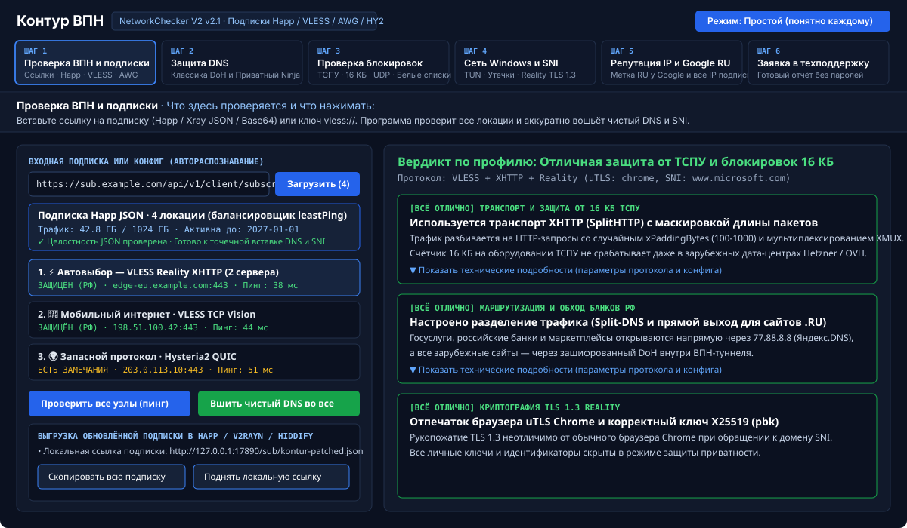
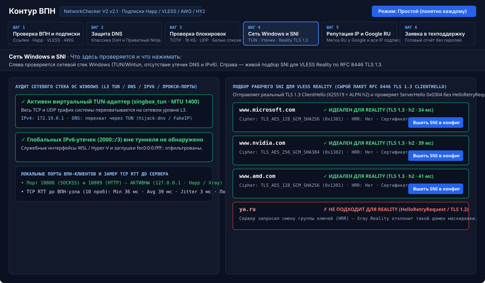

<div align="center">

# 🛡️ Контур ВПН — NetworkChecker V2

**Настольная утилита диагностики ВПН, подписок, ТСПУ-блокировок и «прокажённой метки RU» у Google для Windows**

[](https://dotnet.microsoft.com/)
[](https://learn.microsoft.com/dotnet/csharp/)
[](https://avaloniaui.net/)
[](https://github.com/AnfieldCorsair/NetworkChecker/tree/Version-2.0)

[English README](README.md) · **Русский (README.ru.md)**

</div>

---

## О проекте

**Контур ВПН (NetworkChecker V2)** — автономное Windows-приложение на **.NET 10 / Avalonia UI 12**, созданное для быстрой и понятной диагностики современных ВПН-подключений в условиях ТСПУ РФ.

Приложение работает в **двух режимах**, переключаемых одной кнопкой в верхней панели:

- **Базовый режим (по умолчанию · 3 вкладки)** — минималистичный интерфейс без инженерного шума:
  1. **Проверка ВПН и подписки** — одно поле для ссылки подписки (`https://`) или ключа (`vless://`, `hy2://`, `trojan://`, `vmess://`, `ss://`, AmneziaWG), выбор локации, проверка доступности и разбор простыми словами.
  2. **Репутация IP и Google RU** — комплексный 4-сигнальный тест «прокажённой метки RU» у Google/YouTube и пакетная проверка всех IP из подписки.
  3. **Заявка в техподдержку** — сбор срезов «Без ВПН / С ВПН» и готовый безопасный отчёт для Telegram без утечки ключей и домашнего IP.
- **Расширенный режим (6 вкладок)** — открывает полный инженерный инструментарий: редактор сырых конфигов/JSON, пресеты, локальный хостинг подписки `127.0.0.1`, архитектор DNS (`DoH` / `DoT`), детектор ТСПУ-блокировок (16 КБ / UDP / белые списки), аудит сетевого стека Windows (`TUN` / `IPv6` / `MTU`) и сканер соседей SNI `/24` с живым TLS 1.3 handshake.

---

## 🖼️ Скриншоты интерфейса

### Минималистичный Базовый режим (запуск по умолчанию · 3 вкладки)

> Чистый интерфейс без сырых JSON-полей и лишних панелей: только ссылка/ключ, список локаций, понятный вердикт и быстрая проверка Google RU.


---

### Расширенный режим (6 инженерных вкладок)

#### 1. Проверка ВПН и подписки (Happ / Xray JSON / VLESS / AWG / Hysteria2)


#### 2. Защита DNS (Классика DoH и Приватный Ninja + врезка в конфиг)


#### 3. Проверка блокировок ТСПУ (16 КБ, UDP-звонки, DNS-спуфинг, белые списки)


#### 4. Сеть Windows (TUN / IPv6 / MTU) и Охотник за SNI Reality (TLS 1.3)


#### 5. Репутация IP, 4-сигнальный детектор «метки RU» у Google и все IP подписки


#### 6. Конструктор заявки в техподдержку (Telegram + маскирование секретов)


---

## 🎯 Как работает детектор «прокажённой метки RU» у Google (v2.2)

Даже если ВПН-сервер физически находится в Нидерландах, Германии или Финляндии, Google нередко перепривязывает популярные подсети к России (`RU`) из-за массового трафика смартфонов с российскими Wi-Fi/GPS. В результате перестаёт открываться **Gemini**, пропадает **YouTube Premium**, а поиск начинает выдавать капчу `/sorry/`.

В версии **2.2** модуль проверки Google полностью переработан:

- **Обход EU-баннера согласия (`consent.google.com`)**: ко всем запросам прикрепляются cookie `SOCS` + `CONSENT` и десктопный `User-Agent`, благодаря чему европейские узлы (`DE`, `NL`, `FI`, `PL`) возвращают реальный контент без редиректа на страницу согласия.
- **4 параллельных независимых сигнала**:
  1. **YouTube `INNERTUBE_CONTEXT_GL`** — чтение внутреннего кода страны из `youtube.com/sw.js_data` (ключи + позиционный парсер) с фолбэком на `youtube.com/?hl=en`.
  2. **Доступность YouTube Premium** — проверка `youtube.com/premium?hl=en` на маркер *«not available in your country»* против нормальной зарубежной оферты.
  3. **Доступ к Google Gemini / AI** — проверка `gemini.google.com/app?hl=en` на редирект `/unsupported`, HTTP `403`/`451` и геоблок РФ.
  4. **Google Search (регион и `/sorry/`)** — чтение реальной страны из футера поиска `<div class="uU7dJb">...</div>`, проверка редиректа на `google.ru` и детекция reCAPTCHA `/sorry/` (`HTTP 429`).
- **Консенсус 4 GeoIP-баз** (`ipwho.is`, `ip-api.com`, `ipinfo.io`, `Cloudflare Trace`):
  - **Hosting / ДЦ**: правило большинства (*Majority Vote ≥ 50%*).
  - **Proxy / VPN / Tor**: строгое правило *Any Vote* (срабатывание хотя бы в одной базе).
  - **Совпадение IP (HTTP vs CDN)**: выявляет скрытый сплит-трафик.
- **Пакетный сканер всех IP подписки**: извлекает все узлы из подписки Happ / Xray JSON / списков `vless://`, `hy2://`, `trojan://`, резолвит домены в IP и пакетно оценивает риск метки Google RU и риск лимита ТСПУ 16 КБ по ASN.
- **3 режима маршрутизации** (в Расширенном режиме):
  1. Активный интернет / TUN-адаптер ОС.
  2. Авто-прокси запущенного ВПН-клиента (автопоиск локальных портов `10809`, `10808`, `2080`, `7890`, `1080`).
  3. Ручная проверка произвольного IP или домена без переключения ВПН.

---

## 🏗️ Архитектура решения

```text
NetworkChecker.slnx
├── Directory.Build.props                # .NET 10, C# 14, TreatWarningsAsErrors=true, AnalysisMode=Recommended
├── src/
│   ├── NetworkChecker.Core/             # Бизнес-логика, парсеры и сетевые зонды (без UI-зависимостей)
│   │   └── VpnAudit/
│   │       ├── VpnConfigParser.cs       # Парсер VLESS / XHTTP / Vision / AWG / Hysteria2 / Happ JSON
│   │       ├── VpnConfigAuditor.cs      # Правила аудита РФ + автолечение
│   │       ├── IpReputationProbe.cs     # 4 GeoIP-базы + 4-сигнальный зонд Google RU + сканер IP подписки
│   │       ├── SubscriptionService.cs   # Загрузка подписок, заголовки трафика, локальный сервер 127.0.0.1
│   │       ├── BlockingFingerprintDetector.cs  # Детектор ТСПУ 16 КБ / UDP / белых списков / DNS-спуфинга
│   │       ├── WindowsNetworkStackAuditor.cs   # Аудит адаптеров Windows (TUN, IPv6, MTU, порты прокси)
│   │       ├── SubnetSniScanner.cs      # Охотник за SNI в /24 подсети с проверкой TLS 1.3 ServerHello
│   │       └── SupportTicketBuilder.cs  # Генератор тикетов Telegram с маскированием UUID/ключей/IP
│   └── NetworkChecker.App/              # Avalonia 12.1.4 + CommunityToolkit.Mvvm (Базовый и Расширенный UI)
└── tests/
    └── NetworkChecker.Core.Tests/       # Модульные тесты xUnit (парсеры, Google RU, ТСПУ, стек Windows)
```

---

## 🚀 Сборка и запуск (Windows)

Требуется [.NET 10 SDK](https://dotnet.microsoft.com/download/dotnet/10.0) (Windows 10/11 x64).

```powershell
# 1. Клонировать ветку Version-2.0
git clone -b Version-2.0 https://github.com/AnfieldCorsair/NetworkChecker.git
cd NetworkChecker

# 2. Собрать решение (TreatWarningsAsErrors включён — 0 предупреждений)
dotnet build NetworkChecker.slnx -c Release

# 3. Запустить модульные тесты
dotnet test NetworkChecker.slnx -c Release

# 4. Запустить настольное приложение
dotnet run --project src/NetworkChecker.App -c Release
```

### Сборка автономного EXE (Self-Contained Single File)

```powershell
dotnet publish src/NetworkChecker.App/NetworkChecker.App.csproj `
  -c Release -r win-x64 --self-contained true `
  -p:PublishSingleFile=true -p:IncludeNativeLibrariesForSelfExtract=true
```

---

## 🔒 Приватность и безопасность

- Все проверки выполняются локально с вашего ПК без промежуточных серверов телеметрии.
- UUID, приватные ключи AmneziaWG/Reality, пароли и последние два октета домашнего IP автоматически маскируются при формировании заявки в техподдержку.
- Точечная замена DNS-блока в подписке сохраняет все ваши серверы, ключи и правила маршрутизации без изменений.
